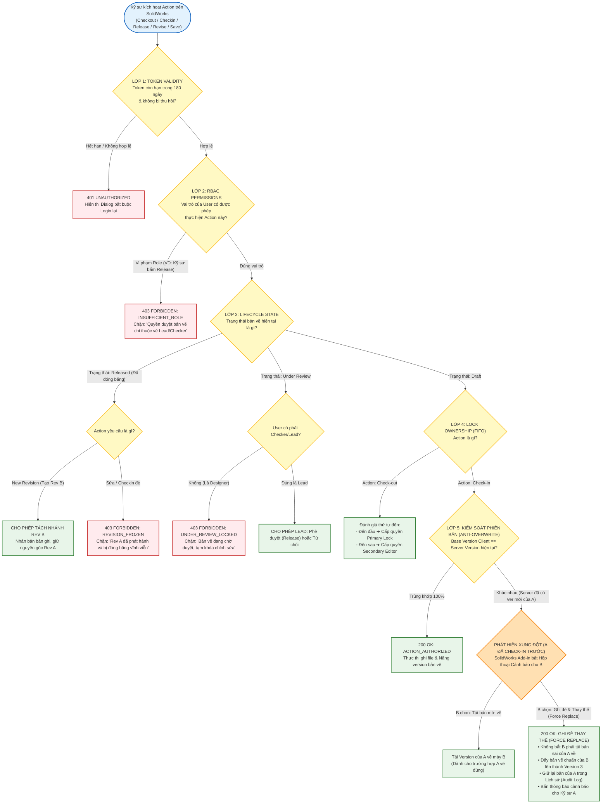
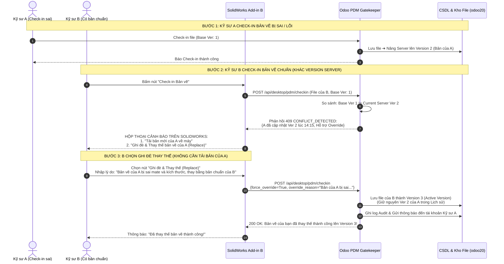
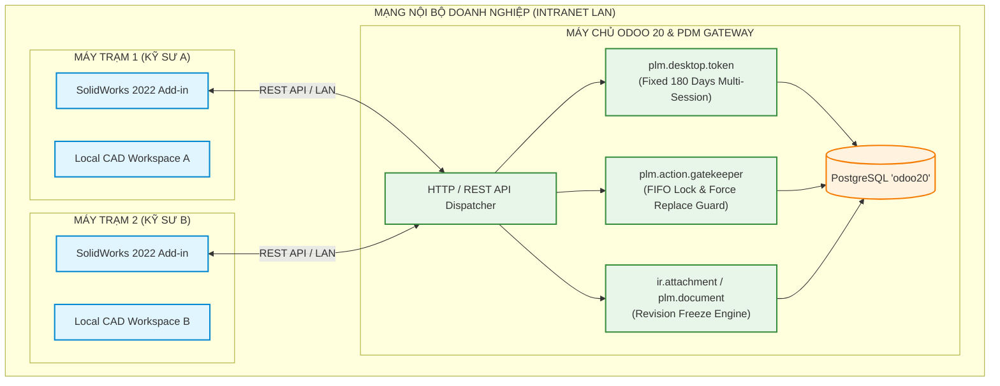
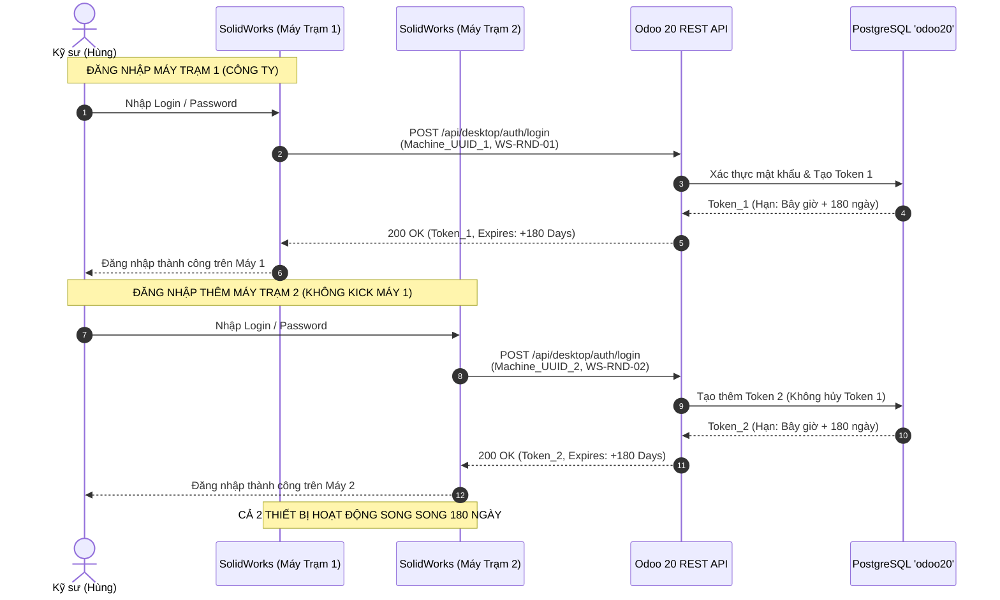
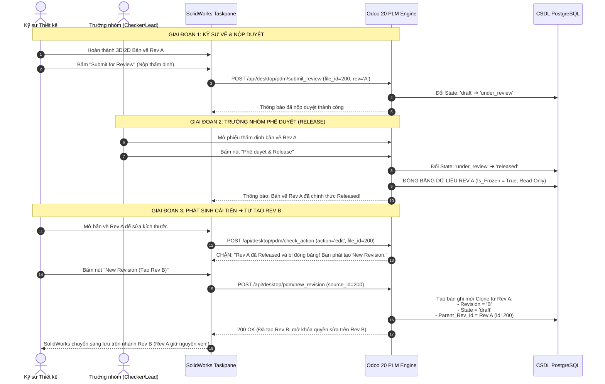

# BÁO CÁO KIẾN TRÚC & THIẾT KẾ PHÂN QUYỀN PDM THỰC THI (TAILORED PDM FRAMEWORK)
# HỆ THỐNG ACCESS TOKEN 180 NGÀY, CƠ CHẾ PHÂN QUYỀN 5 LỚP & XỬ LÝ TRANH CHẤP GHI ĐÈ THAY THẾ (FORCE REPLACE) CHO SOLIDWORKS 2022

> **Đơn vị tư vấn:** Principal PDM Consultant & Solution Architect  
> **Khách hàng / Doanh nghiệp:** Nhà máy Chế tạo Cơ khí / Mạng nội bộ LAN  
> **Hệ thống mục tiêu:** Odoo 20 (PostgreSQL `odoo20`) | OmniaSolutions OdooPLM | SolidWorks 2022 Desktop Add-in  
> **Trạng thái:** ĐÃ CẬP NHẬT CƠ CHẾ CẢNH BÁO & CHO PHÉP GHI ĐÈ THAY THẾ (INTERACTIVE CONFLICT WITH FORCE OVERRIDE)

---

## MỤC 1: TỔNG HỢP CẤU HÌNH DOANH NGHIỆP ĐÃ XÁC LẬP

Dựa trên yêu cầu vận hành thực tế tại doanh nghiệp, hệ thống được thiết lập theo bộ tham số cốt lõi sau:

| Mã quyết định | Hạng mục cấu hình | Phương án xác lập | Mô tả chi tiết hành vi hệ thống |
| :--- | :--- | :--- | :--- |
| **Q1.1** | **Thời hạn Token** | **Option A (Fixed 180 Days)** | Đúng 180 ngày kể từ lúc Login, token hết hạn cứng và bắt buộc đăng nhập lại. Không sử dụng hạn trượt (No Rolling Expiry). |
| **Q1.2** | **Ràng buộc Thiết bị** | **Multi-device Concurrent (Không Kick-out)** | Một kỹ sư được phép đăng nhập trên nhiều máy tính cùng lúc (Workstation, Laptop). Session trên các máy tính độc lập, không bị đăng xuất khi máy khác login. |
| **Q2.1** | **Tranh chấp Check-out & Ghi đè Thay thế** | **FIFO Priority + Lock Handover + Interactive Conflict (Force Replace)** | - **Ưu tiên Check-out trước:** Kỹ sư nào Check-out trước sẽ nắm quyền ưu tiên Check-in (`Primary Lock Holder`).<br>- **Chuyển giao quyền:** Kỹ sư giữ quyền có thể chủ động bàn giao quyền Check-in cho kỹ sư đến sau.<br>- **Cảnh báo & Cho phép Ghi đè Thay thế (Force Replace):** Khi A check-in trước nhưng **sai bản vẽ**, hệ thống **CẢNH BÁO** và **CHO PHÉP** Kỹ sư B ghi đè thay thế bằng bản vẽ chuẩn của B **MÀ KHÔNG BẮT B PHẢI TẢI BẢN SAI CỦA A VỀ MÁY**. Bản của A vẫn được lưu trong lịch sử phiên bản để kiểm toán. |
| **Q3** | **Quy trình Duyệt & Revision** | **Option B + C (2 Cấp + Đóng băng Rev A)** | - Kỹ sư vẽ nộp duyệt ➔ Trưởng nhóm (Lead/Checker) thẩm định và bấm **Released**.<br>- **Đóng băng Rev A:** Bản vẽ Rev A sau khi Released là bất biến (Read-only lịch sử).<br>- Muốn chỉnh sửa tiếp bắt buộc phải bấm **New Revision** để sinh ra **Rev B** độc lập. |
| **Q4.1** | **Môi trường Vận hành** | **LAN Intranet Only (Real-time ACID)** | Vận hành 100% trong mạng nội bộ công ty. Mọi thao tác CAD Add-in đều xác thực và đối chiếu thời gian thực (Real-time) qua Odoo Backend, loại bỏ rủi ro offline. |

---

## MỤC 2: QUY TRÌNH PHÂN QUYỀN TOÀN DIỆN (5-LAYER PDM AUTHORIZATION ENGINE)

Hệ thống phân quyền được xây dựng theo mô hình **Đánh giá Thẩm quyền 5 Lớp (5-Layer Authorization Filter)**. Bất kỳ thao tác nào từ SolidWorks đều phải đi qua bộ lọc logic nghiêm ngặt này trước khi chạm vào cơ sở dữ liệu:

### 1. Sơ đồ Cây Phán Quyết Phân Quyền (Authorization Flowchart)



---

### 2. Sơ đồ Tuần tự Phân quyền & Xử lý Ghi đè Thay thế (Force Replace Sequence)



---

### 3. Ma Trận Quyền Hạn Theo Vai Trò & Vòng Đời (RBAC & State Permission Matrix)

| Thao tác trên SolidWorks | Trạng thái: DRAFT | Trạng thái: UNDER REVIEW | Trạng thái: RELEASED (Đóng Băng) |
| :--- | :---: | :---: | :---: |
| **Download / View 3D** | ✅ Mọi Kỹ sư | ✅ Mọi Kỹ sư | ✅ Mọi Kỹ sư (Kể cả Mua hàng/Sản xuất) |
| **Check-out (Lấy quyền Primary)**| ✅ Kỹ sư đến trước (FIFO) | ❌ Tạm khóa | ❌ Bị cấm tuyệt đối |
| **Check-in thông thường** | ✅ Người giữ quyền | ❌ Tạm khóa | ❌ Bị cấm tuyệt đối |
| **Ghi đè thay thế (Force Replace)**| ✅ **Cho phép khi A check-in sai** | ❌ Tạm khóa | ❌ Bị cấm tuyệt đối |
| **Bàn giao quyền (Handover)** | ✅ Primary Holder giao cho người khác | ❌ Không áp dụng | ❌ Không áp dụng |
| **Nộp duyệt (Submit Review)** | ✅ Kỹ sư dựng hình (Designer) | ❌ Đã nộp rồi | ❌ Đã duyệt xong |
| **Phê duyệt (Release)** | ❌ Chưa được duyệt | ✅ **Chỉ Trưởng nhóm (Checker/Lead)** | ❌ Đã phát hành rồi |
| **Từ chối (Reject to Draft)** | ❌ Không áp dụng | ✅ **Chỉ Trưởng nhóm (Checker/Lead)** | ❌ Không áp dụng |
| **Tạo New Revision (Tách Rev B)** | ❌ Đang là bản thảo | ❌ Phải chờ duyệt xong/reject | ✅ **Mọi Kỹ sư thiết kế** |

---

## MỤC 3: SƠ ĐỒ KIẾN TRÚC TỔNG THỂ HỆ THỐNG (ARCHITECTURE FLOWCHART)

Sơ đồ thể hiện luồng tương tác giữa máy trạm SolidWorks 2022 và máy chủ Odoo 20 qua mạng LAN nội bộ:



---

## MỤC 4: THIẾT KẾ BACKEND ODOO 20 CHI TIẾT

### 1. Model Quản lý Token Đa thiết bị 180 ngày: `plm.desktop.token`
Mỗi thiết bị khi đăng nhập sẽ tạo một bản ghi token độc lập. Không xóa các token cũ của user trên máy tính khác:

```python
# -*- coding: utf-8 -*-
from datetime import timedelta
import secrets
from odoo import api, fields, models

class PlmDesktopToken(models.Model):
    _name = 'plm.desktop.token'
    _description = 'SolidWorks Multi-device Fixed 180-day Token'
    _order = 'issued_at desc, id desc'

    name = fields.Char(string='Token Hash', required=True, index=True, readonly=True)
    user_id = fields.Many2one('res.users', string='Kỹ sư', required=True, ondelete='cascade', index=True)
    machine_uuid = fields.Char(string='Machine UUID', required=True, index=True)
    machine_name = fields.Char(string='Tên máy tính CAD')
    client_ip = fields.Char(string='IP LAN')
    cad_version = fields.Char(string='Phiên bản CAD', default='SolidWorks 2022')
    
    issued_at = fields.Datetime(string='Ngày cấp', default=fields.Datetime.now, readonly=True)
    expires_at = fields.Datetime(string='Hạn chót 180 ngày', required=True, index=True)
    is_revoked = fields.Boolean(string='Bị thu hồi thủ công', default=False)

    is_active = fields.Boolean(string='Còn hiệu lực', compute='_compute_is_active', store=True)

    @api.depends('expires_at', 'is_revoked')
    def _compute_is_active(self):
        now = fields.Datetime.now()
        for rec in self:
            rec.is_active = (not rec.is_revoked) and (rec.expires_at > now)

    @api.model
    def authenticate_device(self, user_id, machine_uuid, machine_name, client_ip, cad_version):
        """Cấp token 180 ngày cố định. Không hủy token trên các thiết bị khác của User."""
        raw_token = secrets.token_urlsafe(48)
        now = fields.Datetime.now()
        expires_at = now + timedelta(days=180)

        token_rec = self.create({
            'name': raw_token,
            'user_id': user_id,
            'machine_uuid': machine_uuid,
            'machine_name': machine_name,
            'client_ip': client_ip,
            'cad_version': cad_version,
            'issued_at': now,
            'expires_at': expires_at,
        })
        return token_rec, raw_token
```

---

### 2. Model Quản lý Khóa Tranh chấp & Lịch sử Ghi đè: `plm.checkout.lock`
Quản lý trạng thái khóa FIFO, chuyển giao quyền (Handover) và cơ chế Force Override:

```python
# -*- coding: utf-8 -*-
from odoo import api, fields, models
from odoo.exceptions import UserError

class PlmCheckoutLock(models.Model):
    _name = 'plm.checkout.lock'
    _description = 'PDM Checkout FIFO Priority, Handover & Force Override Engine'
    _rec_name = 'attachment_id'

    attachment_id = fields.Many2one('ir.attachment', string='Bản vẽ CAD', required=True, ondelete='cascade', index=True)
    primary_user_id = fields.Many2one('res.users', string='Kỹ sư giữ quyền Check-in (FIFO)', required=True)
    primary_machine_uuid = fields.Char(string='Máy trạm giữ quyền')
    lock_time = fields.Datetime(string='Thời điểm khóa', default=fields.Datetime.now)
    
    base_file_hash = fields.Char(string='SHA-1 Hash gốc khi tải về', required=True)
    base_version_number = fields.Integer(string='Version gốc khi tải về', default=1)
    
    secondary_user_ids = fields.Many2many('res.users', string='Kỹ sư đang cùng sửa cục bộ')

    def action_handover_lock(self, new_user_id, new_machine_uuid):
        """Kỹ sư thứ nhất bàn giao quyền Check-in cho kỹ sư thứ hai"""
        self.ensure_one()
        self.write({
            'primary_user_id': new_user_id.id,
            'primary_machine_uuid': new_machine_uuid,
            'lock_time': fields.Datetime.now()
        })

    def action_force_override(self, override_user_id, override_reason, new_attachment_vals):
        """Xử lý Kỹ sư B ghi đè thay thế bản vẽ sai của Kỹ sư A"""
        self.ensure_one()
        # 1. Bảo lưu bản vẽ cũ của A vào lịch sử phiên bản
        old_attachment = self.attachment_id
        self.env['plm.document.history'].create({
            'attachment_id': old_attachment.id,
            'version': old_attachment.version,
            'user_id': old_attachment.write_uid.id,
            'raw_file': old_attachment.raw,
            'note': 'Bị thay thế bởi Kỹ sư %s. Lý do: %s' % (override_user_id.name, override_reason)
        })

        # 2. Cập nhật bản vẽ của B thành phiên bản hiện hành mới
        new_version = old_attachment.version + 1
        old_attachment.write({
            'raw': new_attachment_vals.get('raw'),
            'version': new_version,
            'description': 'Đã ghi đè thay thế bản vẽ lỗi. Lý do: %s' % override_reason
        })

        # 3. Gửi thông báo trong Chatter cho Kỹ sư A
        old_attachment.message_post(
            body="<b>CẢNH BÁO GHI ĐÈ THAY THẾ:</b> Bản vẽ đã được Kỹ sư %s thay thế bằng phiên bản mới (Ver %s).<br>Lý do: <i>%s</i>" % (
                override_user_id.name, new_version, override_reason
            )
        )
```

---

## MỤC 5: CÁC SƠ ĐỒ TUẦN TỰ MERMAID CHI TIẾT (SEQUENCE DIAGRAMS)

### SƠ ĐỒ 1: ĐĂNG NHẬP ĐA THIẾT BỊ VỚI TOKEN CỐ ĐỊNH 180 NGÀY (Q1.1 & Q1.2)



---

### SƠ ĐỒ 2: QUY TRÌNH DUYỆT 2 CẤP, ĐÓNG BĂNG REV A & TÁCH REV B (Q3)



---

## MỤC 6: ĐẶC TẢ 3 REST API CỐT LÕI CHO SOLIDWORKS DESKTOP ADD-IN

### API 1: Đăng nhập Đa thiết bị & Cấp Token 180 ngày Cố định
* **Method & URL:** `POST /api/desktop/auth/login`
* **Request Body:**
  ```json
  {
    "db": "odoo20",
    "login": "hung.cad@congty.vn",
    "password": "MatKhauChinhXac123",
    "machine_uuid": "BFEBFBFF000906EA-DELL-WS01",
    "machine_name": "WS-RND-HUNG",
    "cad_version": "SolidWorks 2022 SP5"
  }
  ```
* **Response Body (200 OK):**
  ```json
  {
    "status": "success",
    "token": "dGhpcyBpcyBhIHNlY3VyZSAxODBkYXkgdG9rZW4gZXhhbXBsZQ...",
    "issued_at": "2026-11-05T14:30:00Z",
    "expires_at": "2027-05-04T14:30:00Z",
    "duration_days": 180,
    "user": {
      "id": 14,
      "name": "Nguyễn Văn Hùng",
      "email": "hung.cad@congty.vn",
      "role": "cad_designer"
    }
  }
  ```

---

### API 2: Cổng Phán quyết Tranh chấp Check-out (FIFO & Handover)
* **Method & URL:** `POST /api/desktop/pdm/check_action`
* **Headers:** `Authorization: Bearer <TOKEN>`
* **Request Body (Khi Kỹ sư B bấm Check-out):**
  ```json
  {
    "action": "checkout",
    "document_id": 5012,
    "file_name": "ROBOT_ARM_BASE.SLDPRT",
    "machine_uuid": "BFEBFBFF000906EA-DELL-WS02"
  }
  ```
* **Response Body (Trường hợp B đến sau - 200 OK):**
  ```json
  {
    "allowed": true,
    "lock_role": "secondary_editor",
    "can_checkin_direct": false,
    "primary_holder": {
      "user_name": "Nguyễn Văn Hùng",
      "machine_name": "WS-RND-HUNG",
      "locked_at": "2026-11-05T08:15:00Z"
    },
    "dialog_title": "Cảnh Báo Quyền Check-In",
    "message_vn": "Kỹ sư Nguyễn Văn Hùng đã Check-out trước và đang giữ quyền Check-in chính. Bạn được phép sửa cục bộ, nhưng nếu Hùng check-in trước, bạn sẽ có quyền chọn ghi đè thay thế nếu bản của Hùng bị sai."
  }
  ```

---

### API 3: Check-in & Xử lý Ghi đè Thay thế (Interactive Conflict & Force Replace)
* **Method & URL:** `POST /api/desktop/pdm/checkin`
* **Headers:** `Authorization: Bearer <TOKEN>`

#### Kịch bản 3A: Bấm Check-in lần đầu khi Server đã có Version 2 của A
* **Request Body:**
  ```json
  {
    "document_id": 5012,
    "base_version": 1,
    "base_hash": "8a9f2d1e7c5b...",
    "new_hash": "3f1a9c4e2d8a...",
    "force_override": false,
    "machine_uuid": "BFEBFBFF000906EA-DELL-WS02"
  }
  ```
* **Response Body (409 Conflict Detected - Bật Hộp thoại trên SolidWorks):**
  ```json
  {
    "status": "conflict_detected",
    "error_code": "CONCURRENT_VERSION_EXISTS",
    "dialog_title": "Phát Hiện Bản Vẽ Đã Cập Nhật",
    "message_vn": "Bản vẽ trên máy chủ đã được Kỹ sư Nguyễn Văn Hùng cập nhật lên Version 2 lúc 14:15. Phiên bản bạn đang sửa dựa trên Version 1 cũ.",
    "server_current_version": 2,
    "updated_by": "Nguyễn Văn Hùng",
    "updated_at": "2026-11-05T14:15:22Z",
    "available_actions": [
      {
        "action_code": "pull_latest",
        "label": "Tải bản mới của Hùng về máy"
      },
      {
        "action_code": "force_override",
        "label": "Ghi đè & Thay thế bản vẽ của Hùng (Replace)"
      }
    ]
  }
  ```

#### Kịch bản 3B: Kỹ sư B chọn nút "Ghi đè & Thay thế (Force Replace)"
* **Request Body:**
  ```json
  {
    "document_id": 5012,
    "base_version": 1,
    "force_override": true,
    "override_reason": "Bản vẽ của Hùng bị sai kích thước then và vỡ Mate lắp ráp, thay thế bằng bản vẽ chuẩn của tôi.",
    "new_hash": "3f1a9c4e2d8a...",
    "raw_file_base64": "UEsDBBQAAAAIA...",
    "machine_uuid": "BFEBFBFF000906EA-DELL-WS02"
  }
  ```
* **Response Body (200 OK - Thay thế thành công):**
  ```json
  {
    "status": "success",
    "action_executed": "force_override_replace",
    "message_vn": "Đã ghi đè thay thế bản vẽ thành công lên Version 3! Bản vẽ cũ của Nguyễn Văn Hùng đã được lưu vào Lịch sử phiên bản và hệ thống đã gửi thông báo đến Hùng.",
    "new_server_version": 3,
    "archived_version": 2
  }
  ```
