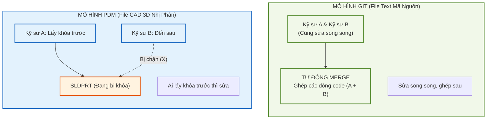
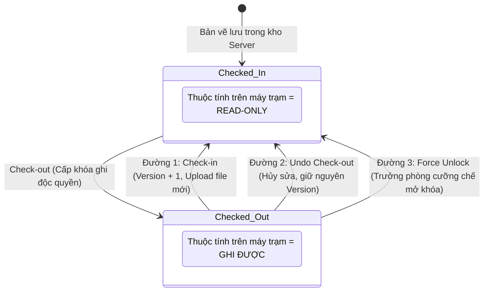
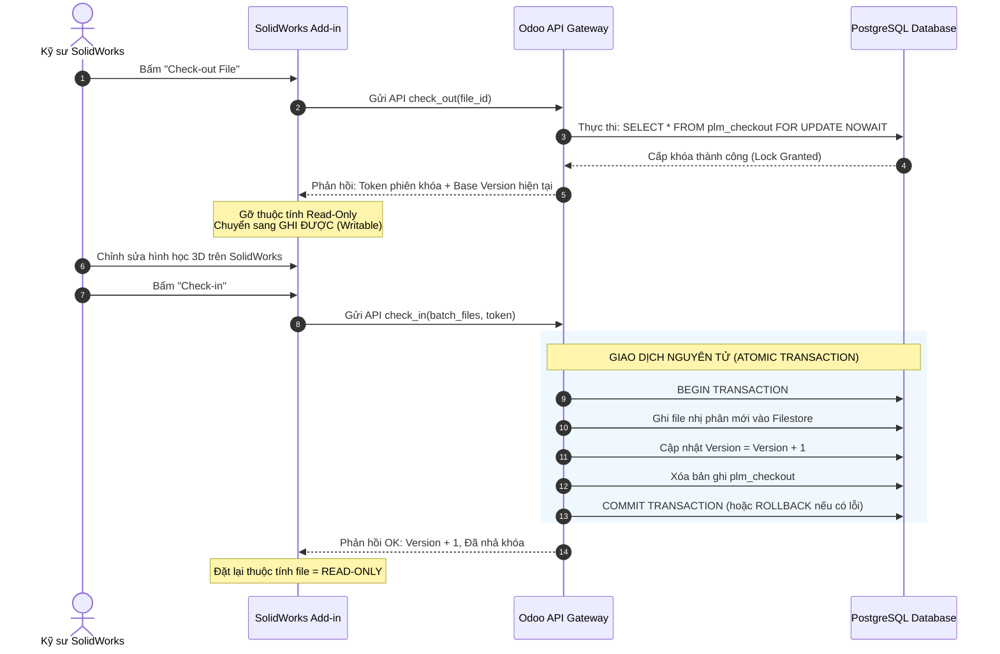
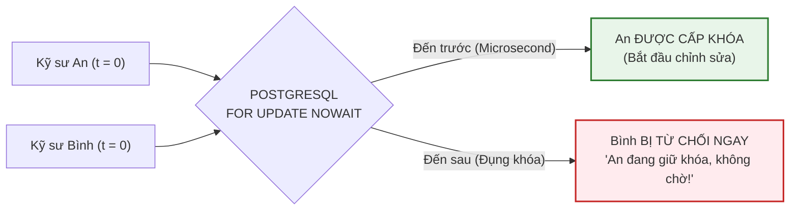
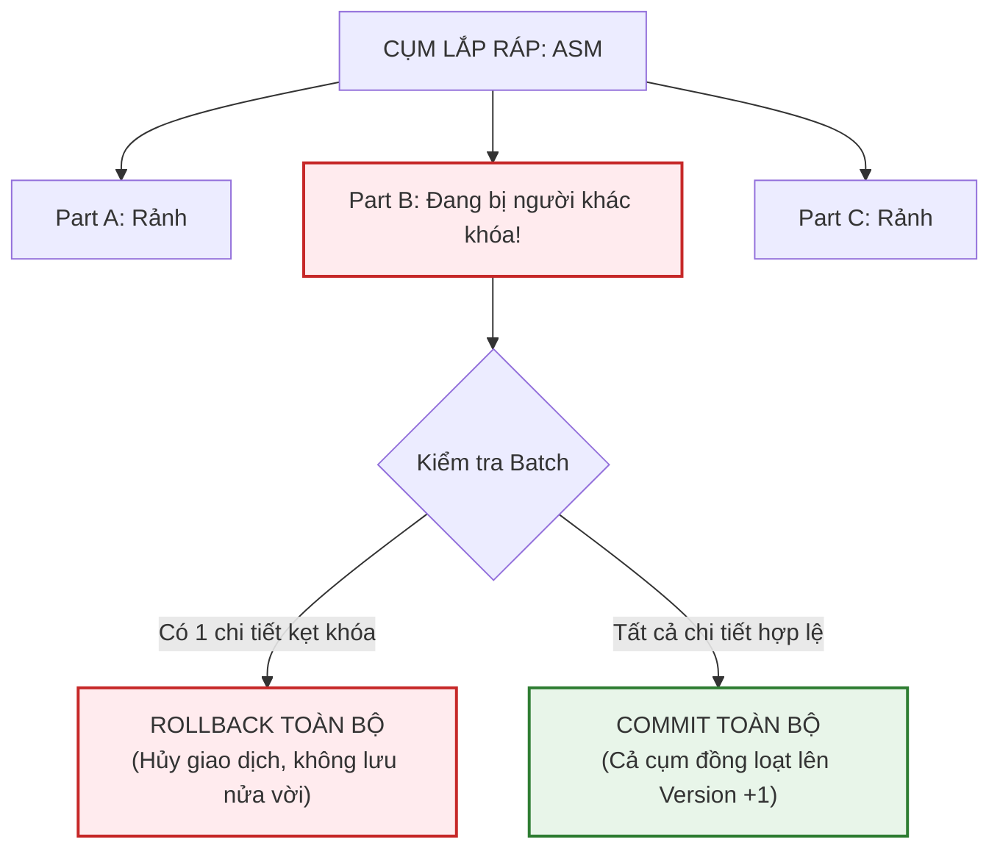
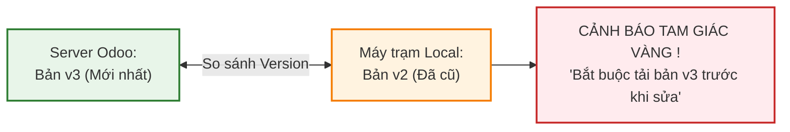
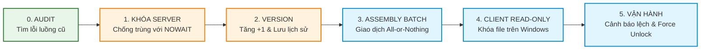

# HƯỚNG DẪN KIẾN TRÚC PDM CHO SOLIDWORKS
## CHECK-IN / CHECK-OUT TRÊN ODOOPLM: KHÓA — VERSION — BATCH

> **Đối tượng người đọc:** Ban Giám đốc, Kỹ sư thiết kế CAD, Đội ngũ Lập trình viên Odoo & CAD Add-in  
> **Hệ sinh thái:** Odoo 20 Community / Enterprise | OmniaSolutions OdooPLM (`addons/plm`) | SolidWorks 2022 Desktop Add-in  
> **Tư tưởng chủ đạo:** **"Khóa, Không Phải Merge" (Pessimistic Locking, Not Merging)** — Chuẩn hóa dữ liệu theo 3 trụ cột: **Khóa (Lock) — Phiên bản (Version) — Giao dịch Khối (Batch)**.

---

## MỤC LỤC
1. [TƯ DUY CỐT LÕI: KHÓA, KHÔNG PHẢI MERGE](#1-tư-duy-cốt-lõi-khóa-không-phải-merge)
2. [VÒNG ĐỜI KHÓA CỦA MỘT TỆP CAD (STATE MACHINE)](#2-vòng-đời-khóa-của-một-tệp-cad-state-machine)
3. [LUỒNG TƯƠNG TÁC KỸ THUẬT: ADD-IN ↔ ODOO ↔ DATABASE](#3-luồng-tương-tác-kỹ-thuật-add-in--odoo--database)
4. [GIẢI QUYẾT 3 BÀI TOÁN SẢN XUẤT THỰC TẾ](#4-giải-quyết-3-bài-toán-sản-xuất-thực-tế)
   - [Bài toán 1: Hai người bấm Check-out cùng lúc (Race Condition tại t=0)](#bài-toán-1-hai-người-bấm-check-out-cùng-lúc-race-condition-tại-t0)
   - [Bài toán 2: Cụm Assembly & Giao dịch Khối (Atomic Batch Transaction)](#bài-toán-2-cụm-assembly--giao-dịch-khối-atomic-batch-transaction)
   - [Bài toán 3: Đồng bộ Local ↔ Server & Bảo vệ thuộc tính File](#bài-toán-3-đồng-bộ-local--server--bảo-vệ-thuộc-tính-file)
5. [KẾ HOẠCH TRIỂN KHAI 6 GIAI ĐOẠN (ROADMAP CHO DEV)](#5-kế-hoạch-triển-khai-6-giai-đoạn-roadmap-cho-dev)

---

## 1. TƯ DUY CỐT LÕI: KHÓA, KHÔNG PHẢI MERGE

Trong phát triển phần mềm, các lập trình viên sử dụng Git để sửa song song trên cùng một file mã nguồn dạng văn bản (text), sau đó ghép lại (merge). Tuy nhiên, **trong kỹ thuật cơ khí 3D, tư duy đó hoàn toàn không thể áp dụng**:

| Tiêu chí | MÔ HÌNH GIT (Code Phần Mềm) | MÔ HÌNH PDM (Bản Vẽ CAD 3D) |
| :--- | :--- | :--- |
| **Định dạng dữ liệu** | Dạng văn bản (Text / Lines of code). | Tệp nhị phân độc quyền (Binary Blobs: `.sldprt`, `.sldasm`). |
| **Cơ chế cộng tác** | **Sửa song song, ghép sau:** Nhiều người sửa cùng lúc, Git tự động merge dòng text. | **Khóa độc quyền (Pessimistic Lock):** Ai lấy khóa trước thì sửa, người đến sau chỉ được đọc. |
| **Khả năng Merge** | Có thể tự động giải quyết conflict theo dòng. | **Tuyệt đối không thể Merge** (sẽ làm hỏng cây tính năng Feature Tree và hình học Parasolid). |

### Tại sao file CAD không thể Merge?
* Tệp SolidWorks (`.sldprt`, `.sldasm`, `.slddrw`) là **tệp nhị phân độc quyền (Binary Blobs)** chứa cây lịch sử tính năng (Feature Tree), tham số hình học nhân Parasolid và các ràng buộc lắp ghép (Mate Constraints).
* Không có bất kỳ công cụ nào có thể tự động ghép 2 thay đổi hình học độc lập (ví dụ: A đổi lỗ ren M8, B vát mép cạnh đáy) mà không làm rách lưới đa giác hoặc làm hỏng mô hình tham số.
* **Quy tắc vàng của PDM cơ khí:** 
  > **Chỉ duy nhất một người được phép sửa một tệp CAD tại một thời điểm (Exclusive Lock). Ai đến trước thì lấy khóa sửa; ai đến sau thì chỉ được mở xem dưới chế độ Chỉ-Đọc (Read-only).**

---

## 2. VÒNG ĐỜI KHÓA CỦA MỘT TỆP CAD (STATE MACHINE)

Một tệp CAD trong kho PDM luôn vận hành xoay quanh 2 trạng thái vật lý và **3 ngả đường** giải phóng khóa:

### Chi tiết 3 ngả đường giải phóng khóa:
1. **Đường 1 — `Check-in` (Hoàn tất chỉnh sửa):**
   * Kỹ sư hoàn thành việc sửa bản vẽ $\rightarrow$ Bấm Check-in từ Add-in.
   * File nhị phân mới được đẩy lên Server Odoo $\rightarrow$ Số **Version tự động tăng +1** (ví dụ: v1 lên v2) $\rightarrow$ Server xóa bản ghi khóa.
   * File trên máy trạm tự động khóa lại thành **Read-only**.
2. **Đường 2 — `Undo Check-out` (Hủy bỏ thao tác):**
   * Kỹ sư mở ra sửa thử nhưng không đạt, muốn hủy bỏ thay đổi.
   * Add-in gửi yêu cầu hủy $\rightarrow$ Server xóa bản ghi khóa mà **không cập nhật file mới**, **giữ nguyên version cũ** $\rightarrow$ File local hoàn nguyên về bản vẽ gốc.
3. **Đường 3 — `Force Unlock` (Cưỡng chế mở khóa / Phá khóa):**
   * Kỹ sư giữ khóa nhưng đột xuất nghỉ việc, đi công tác, hoặc máy tính bị hỏng.
   * Trưởng phòng kỹ thuật (Admin) có thẩm quyền bấm nút phá khóa trên Odoo $\rightarrow$ Server xóa bản ghi khóa, ghi nhận log kiểm toán (audit log) $\rightarrow$ File trở về trạng thái sẵn sàng để người khác tiếp quản.

---

## 3. LUỒNG TƯƠNG TÁC KỸ THUẬT: ADD-IN ↔ ODOO ↔ DATABASE

Quá trình giao tiếp giữa máy trạm SolidWorks, Odoo API Gateway và Cơ sở dữ liệu PostgreSQL diễn ra theo một chu trình 6 bước khép kín và an toàn:

---

## 4. GIẢI QUYẾT 3 BÀI TOÁN SẢN XUẤT THỰC TẾ

---

### Bài toán 1: Hai người bấm Check-out cùng lúc (Race Condition tại t=0)

* **Tình huống:** Kỹ sư **An** và Kỹ sư **Bình** cùng mở một chi tiết và cùng bấm Check-out vào đúng mili-giây $t=0$.
* **Hậu quả nếu xử lý sai:** Cả hai cùng nghĩ mình đang giữ khóa, cùng sửa và người bấm lưu sau sẽ xóa sạch công sức của người bấm trước.
* **Giải pháp dứt điểm:** Sử dụng cơ chế **`FOR UPDATE NOWAIT`** của PostgreSQL.

* **Nguyên lý hoạt động:**
  1. Giao dịch của An đến cơ sở dữ liệu trước một phần triệu giây $\rightarrow$ PostgreSQL cấp khóa độc quyền cho An.
  2. Giao dịch của Bình đến sau lập tức đụng cờ `NOWAIT` $\rightarrow$ Cơ sở dữ liệu **từ chối ngay mà không treo ứng dụng** (không bắt Bình phải chờ timeout).
  3. Odoo bắt lỗi và trả về ngay thông báo cho Bình: *"Chi tiết đang được sửa bởi An (bắt đầu lúc 08:30). Bạn chỉ có quyền đọc (Read-only)."*

---

### Bài toán 2: Cụm Assembly & Giao dịch Khối (Atomic Batch Transaction)

Trong cơ khí, hiếm khi kỹ sư làm việc với 1 chi tiết đơn lẻ mà thường làm việc với cả một cụm máy (**Assembly**) gồm hàng chục Part con.

* Khi thực hiện Check-in / Check-out theo lô (Batch):
  * **Toàn bộ linh kiện thành công:** Odoo mới ghi nhận `COMMIT`. Tất cả chi tiết đồng loạt lên Version mới.
  * **Chỉ cần 1 linh kiện bị lỗi:** Odoo lập tức kích hoạt `ROLLBACK` toàn bộ giao dịch. Trả thông báo lỗi rõ ràng: *"Giao dịch hủy bỏ vì Part B đang bị Kỹ sư Tuấn khóa"*. Không để lại bất kỳ rác dữ liệu nào.

---

### Bài toán 3: Đồng bộ Local ↔ Server & Bảo vệ thuộc tính File

Xung đột phổ biến nhất tại các phòng thiết kế là kỹ sư sửa file ở máy tính cá nhân nhưng không biết trên Server đã có bản mới hơn do đồng nghiệp vừa tải lên.

* **Cơ chế 2 lớp bảo vệ:**
  1. **Lớp 1 — Khóa thuộc tính File hệ điều hành Windows (OS File Attributes):**
     * Khi file chưa được Check-out: Add-in tự động đặt thuộc tính file trên ổ cứng máy trạm là **`Read-Only`**. Kỹ sư mở trên SolidWorks chỉ có thể xem, nếu bấm `Ctrl + S` SolidWorks sẽ báo lỗi cấm ghi.
     * Khi Check-out thành công: Add-in mới gỡ thuộc tính Read-Only, cho phép ghi bình thường.
  2. **Lớp 2 — Cảnh báo lệch Version (Stale Cache Detection):**
     * Trước khi mở file hoặc Check-out, Add-in luôn đối chiếu Version giữa Local và Server.
     * Nếu phát hiện Server đang là bản `v3` mà Local chỉ có bản `v2` $\rightarrow$ Hiển thị **Cảnh báo màu vàng** và ép buộc kỹ sư tải bản mới nhất về đè lên bản cũ trước khi thực hiện bất kỳ thao tác nào.

---

## 5. KẾ HOẠCH TRIỂN KHAI 6 GIAI ĐOẠN (ROADMAP CHO DEV)

Lộ trình triển khai được chia thành 6 giai đoạn rõ ràng, có thể kiểm thử và bàn giao độc lập từng bước:

### Chi tiết nhiệm vụ kỹ thuật cho từng giai đoạn:

| Giai đoạn | Tên Giai Đoạn | Nhiệm vụ chính của Lập trình viên Odoo (Backend) | Nhiệm vụ chính của Lập trình viên Add-in (Client) |
| :-: | :--- | :--- | :--- |
| **0** | **Audit (Tìm lỗi)** | Rà soát toàn bộ code [`plm_checkout.py`](file:///c:/Work/odoo20-docker/addons/plm/models/plm_checkout.py) và các controller upload hiện tại để phát hiện các kịch bản nghẽn mạng hoặc kẹt session. | Kiểm tra các hàm bắt sự kiện Save/Open trong mã nguồn C# của SolidWorks Add-in. |
| **1** | **Khóa Server không trùng** | Bổ sung ràng buộc `unique (documentid)` và áp dụng câu lệnh `FOR UPDATE NOWAIT` vào API `check-out`. Đảm bảo trả về mã lỗi ngay khi có xung đột. | Bắt mã lỗi từ chối của Server và hiển thị Popup: *"File đang được giữ khóa bởi [Tên người giữ]"*. |
| **2** | **Version có lịch sử** | Kế thừa [`revision.plm.mixin`](file:///c:/Work/odoo20-docker/addons/plm/models/plm_mixin.py) để tự động tăng Version +1 sau khi Check-in. Kích hoạt [`plm.backupdoc`](file:///c:/Work/odoo20-docker/addons/plm/models/plm_backup_document.py) lưu trữ tệp nhị phân cũ vào kho lịch sử. | Hiển thị số Version hiện tại của chi tiết trực tiếp trên cây thư mục FeatureTree của SolidWorks. |
| **3** | **Assembly Batch** | Xây dựng API tiếp nhận danh sách file theo mảng (Array). Bọc toàn bộ quá trình xử lý trong khối `with cr.savepoint():` để tự động Rollback nếu 1 chi tiết thất bại. | Thu thập toàn bộ cây phụ thuộc của cụm máy và đóng gói gửi lên Server trong một request duy nhất. |
| **4** | **Client Read-only** | Cung cấp API trả về trạng thái khóa nhanh (`get_checkout_snapshot`) để Client tra cứu. | Viết code can thiệp thuộc tính Windows File System (`FileInfo.IsReadOnly = true/false`) tương ứng theo trạng thái Check-out. |
| **5** | **Vận hành & Cảnh báo** | Xây dựng nút bấm **"Force Unlock"** trên giao diện Odoo có phân quyền cho Trưởng phòng, bắt buộc nhập lý do và ghi vào Chatter kiểm toán. | Viết logic so sánh $v_{server} \neq v_{local}$, bật cảnh báo và nút "Get Latest Version" khi phát hiện file local bị cũ. |

---

## 6. KẾT LUẬN

Bộ quy chuẩn **"Khóa — Version — Batch"** này là nền tảng sống còn của một hệ thống PDM thực thụ:
* **Đơn giản:** Không làm phức tạp hóa hệ thống bằng các cơ chế rẽ nhánh/merge phần mềm không tương thích với CAD.
* **Chính xác tuyệt đối:** Bảo vệ hình học 3D, loại bỏ nguy cơ ghi đè mất dữ liệu.
* **Ổn định:** Cơ chế `NOWAIT` và `Atomic Batch` triệt tiêu hoàn toàn lỗi treo phần mềm và lỗi gãy cụm lắp ráp.

