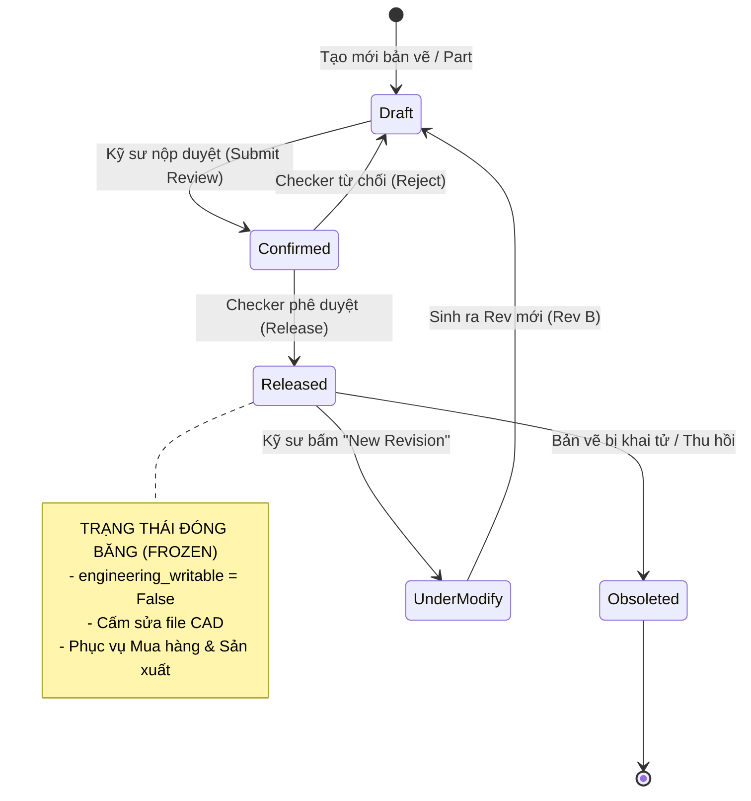

# BÁO CÁO KIẾN TRÚC MÔ HÌNH HỆ THỐNG ODOOPLM
## XÁC ĐỊNH & PHÂN TÍCH CHUYÊN SÂU 4 THỰC THỂ CỐT LÕI: DOCUMENT, REVISION, ATTACHMENT, BOM

> **Tài liệu Kỹ thuật Kiến trúc Hệ thống Odoo 20 PLM (Senior Odoo PLM Architect Report)**  
> **Dự án:** Hệ thống Quản trị Vòng đời Sản phẩm & Tích hợp CAD (SolidWorks / Inventor)  
> **Các module thẩm tra mã nguồn:**
> - Module cốt lõi: [`addons/plm`](file:///c:/Work/odoo20-docker/addons/plm) (OmniaSolutions OdooPLM)
> - Module mở rộng: [`custom_addons/tdb_plm_custom`](file:///c:/Work/odoo20-docker/custom_addons/tdb_plm_custom) (TDB CAD Extension Layer)
> **Ngày lập:** 07/11/2026

---

## MỤC LỤC
1. [TỔNG QUAN KIẾN TRÚC THỰC THỂ ODOOPLM](#1-tổng-quan-kiến-trúc-thực-thể-odooplm)
2. [SƠ ĐỒ THỰC THỂ QUAN HỆ TOÀN DIỆN (COMPREHENSIVE PLM ERD)](#2-sơ-đồ-thực-thể-quan-hệ-toàn-diện-comprehensive-plm-erd)
3. [THỰC THỂ 1: DOCUMENT (TÀI LIỆU KỸ THUẬT & BẢN VẼ CAD)](#3-thực-thể-1-document-tài-liệu-kỹ-thuật--bản-vẽ-cad)
4. [THỰC THỂ 2: REVISION (QUẢN TRỊ PHIÊN BẢN & VÒNG ĐỜI KỸ THUẬT)](#4-thực-thể-2-revision-quản-trị-phiên-bản--vòng-đời-kỹ-thuật)
5. [THỰC THỂ 3: ATTACHMENT (LƯU TRỮ NHỊ PHÂN & CÂY PHỤ THUỘC CAD)](#5-thực-thể-3-attachment-lưu-trữ-nhị-phân--cây-phụ-thuộc-cad)
6. [THỰC THỂ 4: BOM (ĐỊNH MỨC KỸ THUẬT EBOM & ĐỊNH MỨC SẢN XUẤT MBOM)](#6-thực-thể-4-bom-định-mức-kỹ-thuật-ebom--định-mức-sản-xuất-mbom)
7. [CƠ CHẾ VẬN HÀNH THỰC TẾ & MÔ HÌNH BIẾN ĐỘNG DỮ LIỆU](#7-cơ-chế-vận-hành-thực-tế--mô-hình-biến-động-dữ-liệu)
8. [BẢNG TỔNG HỢP ÁNH XẠ MODEL, TABLE & SOURCE FILE](#8-bảng-tổng-hợp-ánh-xạ-model-table--source-file)

---

## 1. TỔNG QUAN KIẾN TRÚC THỰC THỂ ODOOPLM

Khác với các hệ thống PDM/PLM đóng gói độc lập, kiến trúc của OdooPLM được xây dựng trên triết lý **kế thừa và mở rộng trực tiếp cấu trúc cốt lõi của Odoo ERP** (ERP-native PLM). Điều này giúp dữ liệu kỹ thuật từ CAD hòa nhập liền mạch vào quy trình Chuỗi cung ứng, Mua hàng và Sản xuất.

4 thực thể cốt lõi được tổ chức theo kiến trúc phân tầng:
1. **Document (Tài liệu kỹ thuật / Bản vẽ CAD):** Không xây dựng bảng rời mà kế thừa trực tiếp từ [`ir.attachment`](file:///c:/Work/odoo20-docker/addons/plm/models/ir_attachment.py), bổ sung thuộc tính PLM, cờ kiểm soát và gắn kết đa chiều với Sản phẩm (Component).
2. **Revision (Quản trị phiên bản & Vòng đời):** Được trừu tượng hóa thành một lớp Mixin dùng chung [`revision.plm.mixin`](file:///c:/Work/odoo20-docker/addons/plm/models/plm_mixin.py#L79), được kế thừa song song bởi cả Document (`ir.attachment`) và Linh kiện (`product.template` / `product.product`).
3. **Attachment (Lưu trữ nhị phân & Cây quan hệ phụ thuộc):** Tách bạch giữa **tệp nhị phân vật lý** (Filestore) và **quan hệ cấu trúc cây lắp ráp CAD** (Hierarchy Tree) thông qua bảng quan hệ độc lập [`ir.attachment.relation`](file:///c:/Work/odoo20-docker/addons/plm/models/ir_attachment_relations.py).
4. **BOM (Định mức nguyên vật liệu):** Kế thừa từ phân hệ sản xuất gốc [`mrp.bom`](file:///c:/Work/odoo20-docker/addons/plm/models/mrp_bom.py) và [`mrp.bom.line`](file:///c:/Work/odoo20-docker/addons/plm/models/mrp_bom_line.py), bổ sung khả năng liên kết ngược với tài liệu CAD gốc (`source_id`), phân định rõ ràng giữa **eBOM** (Engineering BOM từ CAD) và **mBOM** (Manufacturing BOM xưởng sản xuất).

---

## 2. SƠ ĐỒ THỰC THỂ QUAN HỆ TOÀN DIỆN (COMPREHENSIVE PLM ERD)

Sơ đồ thể hiện chính xác mối quan hệ liên kết dữ liệu giữa các model trong CSDL PostgreSQL `odoo20`:

```mermaid
erDiagram
    REVISION_MIXIN ||--|> IR_ATTACHMENT : "inherits (Schema & Lifecycle)"
    REVISION_MIXIN ||--|> PRODUCT_TEMPLATE : "inherits (Schema & Lifecycle)"
    PRODUCT_TEMPLATE ||--|{ PRODUCT_PRODUCT : "has variants"

    IR_ATTACHMENT ||--o{ PLM_COMPONENT_DOC_REL : "linked via document_id"
    PRODUCT_PRODUCT ||--o{ PLM_COMPONENT_DOC_REL : "linked via component_id"

    IR_ATTACHMENT ||--o{ IR_ATTACHMENT_RELATION : "as parent_id"
    IR_ATTACHMENT ||--o{ IR_ATTACHMENT_RELATION : "as child_id"

    IR_ATTACHMENT ||--o{ PLM_CHECKOUT : "locked by (unique)"
    IR_ATTACHMENT ||--o{ PLM_BACKUPDOC : "physical backup history"
    IR_ATTACHMENT ||--o{ PLM_CAD_OPEN : "logged workspace activity"

    PRODUCT_PRODUCT ||--o{ MRP_BOM : "manufactures product_id"
    IR_ATTACHMENT ||--o{ MRP_BOM : "declares as source_id"
    MRP_BOM ||--|{ MRP_BOM_LINE : "contains bom_line_ids"
    PRODUCT_PRODUCT ||--o{ MRP_BOM_LINE : "consumes component"
    IR_ATTACHMENT ||--o{ MRP_BOM_LINE : "source_id"

    IR_ATTACHMENT {
        int id PK
        string engineering_code "Mã bản vẽ CAD"
        int engineering_revision "Chỉ số phiên bản (0, 1, 2...)"
        string engineering_state "Trạng thái (draft, released...)"
        boolean engineering_writable "Cờ cho phép ghi"
        string document_type "2D | 3D | PR | other"
        boolean is_plm "Đánh dấu tài liệu kỹ thuật"
        bytea preview "Ảnh render thumbnail"
        bytea printout "Bản in PDF"
        string store_fname "Tên file nhị phân trong filestore"
    }

    PRODUCT_PRODUCT {
        int id PK
        int product_tmpl_id FK
        string default_code "Mã nội bộ linh kiện"
        int engineering_revision "Phiên bản linh kiện"
        string engineering_material "Vật liệu từ CAD"
        string engineering_surface "Xử lý bề mặt CAD"
    }

    PLM_COMPONENT_DOC_REL {
        int id PK
        int component_id FK "product.product"
        int document_id FK "ir.attachment"
    }

    IR_ATTACHMENT_RELATION {
        int id PK
        int parent_id FK "Tài liệu cha (Assembly / 2D)"
        int child_id FK "Tài liệu con (Part / 3D / ZIP)"
        string link_kind "HiTree | LyTree | PkgTree | ExtraTree | RfTree"
        string configuration "Cấu hình CAD (Default, Mirror...)"
    }

    PLM_CHECKOUT {
        int id PK
        int documentid FK "Tài liệu bị khóa (UNIQUE)"
        int userid FK "Kỹ sư đang giữ khóa"
        string hostname "Tên máy trạm CAD"
        string hostpws "Thư mục PWS máy trạm"
    }

    PLM_BACKUPDOC {
        int id PK
        int documentid FK
        int userid FK
        string existingfile "Đường dẫn file backup trong filestore"
        string orig_data_fstore "Tên file gốc trước khi ghi đè"
    }

    MRP_BOM {
        int id PK
        int product_id FK "Sản phẩm đầu ra"
        int source_id FK "ir.attachment (Bản vẽ CAD Assembly)"
        string type "normal (mBOM) | ebom (eBOM) | phantom"
        int engineering_revision "Phiên bản BOM"
        float weight_net "Khối lượng tính toán"
    }

    MRP_BOM_LINE {
        int id PK
        int bom_id FK "BOM cha"
        int product_id FK "Linh kiện tiêu hao"
        int itemnum "Vị trí Balloon trên bản vẽ CAD"
        string itemlbl "Nhãn vị trí linh kiện"
        int source_id FK "ir.attachment gốc"
        float product_qty "Số lượng định mức"
    }
```

---

## 3. THỰC THỂ 1: DOCUMENT (TÀI LIỆU KỸ THUẬT & BẢN VẼ CAD)

### 3.1. Định Danh Mô Hình & Mã Nguồn
- **Tên kỹ thuật Model (`_name`):** `ir.attachment`
- **Kế thừa (`_inherit`):** `["revision.plm.mixin", "ir.attachment"]`
- **Tên bảng PostgreSQL (`_table`):** `ir_attachment`
- **Đường dẫn file mã nguồn:**
  [`addons/plm/models/ir_attachment.py`](file:///c:/Work/odoo20-docker/addons/plm/models/ir_attachment.py)

### 3.2. Bản Chất Kiến Trúc
Trong OdooPLM, đối tượng Document là thực thể trung tâm đại diện cho file bản vẽ CAD (Part `.sldprt`, Assembly `.sldasm`, Drawing 2D `.slddrw` hoặc các định dạng của Autodesk Inventor). Bằng cách kế thừa trực tiếp `ir.attachment`, OdooPLM tận dụng toàn bộ hạ tầng lưu trữ Filestore chuẩn của Odoo đồng thời bổ sung thêm các trường siêu dữ liệu kỹ thuật và hành vi PDM chuyên sâu.

### 3.3. Các Trường Dữ Liệu Cốt Lõi (Core Fields)

| Tên Trường (Field Name) | Kiểu Dữ Liệu | Nguồn gốc / Thuộc tính | Mục Đích Nghiệp Vụ & Ý Nghĩa Kỹ Thuật |
| :--- | :--- | :--- | :--- |
| `is_plm` | `Boolean` | Gốc PLM (`default=True`) | Cờ phân tách: `True` xác định đây là tài liệu kỹ thuật CAD, kích hoạt các luật kiểm tra quyền Check-out; `False` là tài liệu Odoo thông thường (hóa đơn, chứng từ). |
| `engineering_code` | `Char` | Kế thừa từ `revision.plm.mixin` | Mã số bản vẽ / Mã định danh kỹ thuật duy nhất (VD: `DRAW-2026-001`). |
| `engineering_revision`| `Integer` | Kế thừa từ `revision.plm.mixin` | Chỉ số phiên bản dạng số nguyên (0, 1, 2, 3...). |
| `engineering_revision_letter`| `Char` | Kế thừa từ `revision.plm.mixin` | Ký hiệu phiên bản dạng chữ cái (A, B, C... AA, AB...). |
| `document_type` | `Selection` | Gốc PLM | Phân loại tệp CAD: `'2D'` (Bản vẽ phẳng), `'3D'` (Khối chi tiết/Cụm lắp), `'PR'` (Tài liệu quy trình), `'other'` (Tài liệu phụ trợ, PkgTree ZIP). |
| `engineering_state` | `Selection` | Kế thừa từ `revision.plm.mixin` | Trạng thái vòng đời: `'draft'`, `'confirmed'`, `'released'`, `'undermodify'`, `'obsoleted'`. |
| `engineering_writable`| `Boolean` | Kế thừa từ `revision.plm.mixin` | Cờ kiểm soát quyền ghi nhị phân. Chỉ bật `True` khi tài liệu được Check-out thành công cho người dùng hiện tại. |
| `must_update_from_cad`| `Boolean` | Gốc PLM | Cờ cảnh báo: Bật `True` khi bản vẽ trên server đã có phiên bản mới hơn phiên bản đang mở tại máy trạm cục bộ. |
| `printout` | `Binary` | Gốc PLM | Lưu trữ chuỗi nhị phân (Base64) của tệp PDF kết xuất từ bản vẽ 2D, phục vụ xem nhanh cho xưởng sản xuất và phòng mua hàng. |
| `preview` | `Image` | Gốc PLM (`max_width=1920`) | Lưu ảnh Thumbnail 3D render trích xuất từ phần mềm CAD (PNG, JPEG). |
| `linkedcomponents` | `Many2many` | Bảng trung gian `plm_component_document_rel` | Danh sách các linh kiện / sản phẩm (`product.product`) được mô tả bởi bản vẽ này. |
| `checkout_ids` | `One2many` | Trỏ tới `plm.checkout` | Bản ghi khóa độc quyền đang active (nếu đang được Check-out). |
| `checkout_user` | `Char` | Compute field | Tên kỹ sư đang giữ bản quyền ghi của tài liệu. |

### 3.4. Ràng Buộc Tính Toàn Vẹn Dữ Liệu
Tại [`addons/plm/models/plm_mixin.py`](file:///c:/Work/odoo20-docker/addons/plm/models/plm_mixin.py#L123), hệ thống áp đặt ràng buộc độc nhất:
```python
@api.constrains("engineering_code", "engineering_revision")
def _check_engineering_constraints(self):
    for rec in self:
        if rec.engineering_code:
            domain = [
                ("engineering_code", "=", rec.engineering_code),
                ("engineering_revision", "=", rec.engineering_revision),
                ("id", "!=", rec.id),
            ]
            if self.sudo().search_count(domain):
                raise ValidationError("This Engineering Code and Revision combination already exists!")
```
Cặp `(engineering_code, engineering_revision)` là duy nhất trên phạm vi toàn bộ cơ sở dữ liệu.

---

## 4. THỰC THỂ 2: REVISION (QUẢN TRỊ PHIÊN BẢN & VÒNG ĐỜI KỸ THUẬT)

### 4.1. Định Danh Mô Hình & Mã Nguồn
- **Tên kỹ thuật Model (`_name`):** `revision.plm.mixin`
- **Loại mô hình:** `models.AbstractModel` (Lớp trừu tượng tái sử dụng)
- **Kế thừa (`_inherit`):** `["mail.thread", "mail.activity.mixin"]`
- **Đường dẫn file mã nguồn:**
  [`addons/plm/models/plm_mixin.py`](file:///c:/Work/odoo20-docker/addons/plm/models/plm_mixin.py#L79)

### 4.2. Bản Chất Kiến Trúc
`revision.plm.mixin` là xương sống quản trị vòng đời sản phẩm của OdooPLM. Thay vì quản lý phiên bản theo kiểu lưu log thông thường, OdooPLM áp dụng mô hình **Bản Ghi Độc Lập Cho Từng Phiên Bản (Immutable Revision Record)**:
- Mỗi khi tăng Revision (vd: từ Rev 0 lên Rev 1, hoặc từ Rev A lên Rev B), hệ thống **nhân bản một bản ghi vật lý mới** trong cơ sở dữ liệu.
- Phiên bản cũ được **đóng băng (Freeze)** thành bản ghi chỉ đọc (Read-only lịch sử), không bao giờ bị ghi đè.
- Cả **Tài liệu CAD** ([`ir.attachment`](file:///c:/Work/odoo20-docker/addons/plm/models/ir_attachment.py)) và **Linh kiện Sản phẩm** ([`product.template`](file:///c:/Work/odoo20-docker/addons/plm/models/product_template.py), [`product.product`](file:///c:/Work/odoo20-docker/addons/plm/models/product_product.py)) đều kế thừa mixin này để đồng bộ hóa trạng thái vòng đời.

### 4.3. Các Trường Dữ Liệu Cốt Lõi (Core Fields)

| Tên Trường | Kiểu Dữ Liệu | Ý Nghĩa Kỹ Thuật & Nghiệp Vụ Vòng Đời |
| :--- | :--- | :--- |
| `engineering_code` | `Char` | Mã định danh kỹ thuật của đối tượng (dùng chung xuyên suốt các thế hệ Revision). |
| `engineering_revision` | `Integer` | Chỉ số nguyên đại diện cho thứ tự phiên bản (`0` = Gốc, `1` = Lần sửa 1, `2` = Lần sửa 2...). |
| `engineering_revision_letter` | `Char` | Ký tự chữ tương ứng (`default="A"`). Tự động tính toán: 0 ➔ A, 1 ➔ B ... 25 ➔ Z, 26 ➔ AA. |
| `engineering_state` | `Selection` | Trạng thái vòng đời hiện tại (Draft, Confirmed, Released, Under Modify, Obsoleted). |
| `engineering_release_user` | `Many2one` (`res.users`) | Kỹ sư trưởng / Checker thực hiện phê duyệt phát hành bản vẽ. |
| `engineering_release_date` | `Datetime` | Dấu thời gian chính xác khi bản vẽ được chuyển sang trạng thái `Released`. |
| `engineering_revision_user`| `Many2one` (`res.users`) | Người kích hoạt tạo New Revision. |
| `engineering_revision_date`| `Datetime` | Thời điểm phát sinh New Revision. |
| `engineering_writable` | `Boolean` | Khóa bảo vệ tầng ORM: `False` ngăn cản mọi thao tác cập nhật dữ liệu. |

### 4.4. Cấu Trúc Máy Trạng Thái Vòng Đời Kỹ Thuật (Lifecycle State Machine)



Danh sách các trạng thái bị cấm ghi tuyệt đối được định nghĩa tại [`addons/plm/models/plm_mixin.py`](file:///c:/Work/odoo20-docker/addons/plm/models/plm_mixin.py#L55):
```python
PLM_NO_WRITE_STATE = [
    "confirmed",    # Đang chờ duyệt
    "released",     # Đã phát hành chính thức
    "undermodify",  # Đang trong quá trình tạo revision mới
    "obsoleted",    # Đã lỗi thời
]
```
Chỉ duy nhất trạng thái `"draft"` mới cho phép kỹ sư cập nhật file nhị phân và thuộc tính kỹ thuật.

---

## 5. THỰC THỂ 3: ATTACHMENT (LƯU TRỮ NHỊ PHÂN & CÂY PHỤ THUỘC CAD)

Kiến trúc tệp đính kèm trong OdooPLM được phân tách rành mạch thành 2 tầng: **Tầng nhị phân vật lý** và **Tầng quan hệ cấu trúc cây lắp ráp (Hierarchy Relations)**.

### 5.1. Tầng Nhị Phân Vật Lý & Sao Lưu (Physical Storage & Backup)
- File nhị phân CAD gốc được lưu tại trường `raw` của `ir.attachment`.
- Khi ghi đè file CAD (hàm `_inverse_raw` trong [`ir_attachment.py`](file:///c:/Work/odoo20-docker/addons/plm/models/ir_attachment.py#L306)), hệ thống tự động kiểm tra xem bản ghi hiện tại đã được sao lưu chưa. Nếu chưa, OdooPLM kích hoạt nhân bản file vật lý trong Filestore và tạo một bản ghi sao lưu trong model:
  - **Tên Model:** [`plm.backupdoc`](file:///c:/Work/odoo20-docker/addons/plm/models/plm_backup_document.py)
  - **Bảng PostgreSQL:** `plm_backupdoc`
  - **Trường lưu trữ:** `existingfile` (Đường dẫn tương đối trong Filestore), `orig_data_fstore`, `printout`, `preview`, `documentid`.
  - **Quyền hạn:** Chỉ có thành viên nhóm `plm.group_plm_admin` mới có quyền dọn dẹp hoặc xóa bản ghi này.

---

### 5.2. Tầng Quan Hệ Cấu Trúc Cây Phụ Thuộc: Model `ir.attachment.relation`

- **Tên kỹ thuật Model (`_name`):** `ir.attachment.relation`
- **Tên bảng PostgreSQL (`_table`):** `ir_attachment_relation`
- **Đường dẫn mã nguồn:**
  [`addons/plm/models/ir_attachment_relations.py`](file:///c:/Work/odoo20-docker/addons/plm/models/ir_attachment_relations.py)

#### Các Trường Dữ Liệu Cốt Lõi:
| Tên Trường | Kiểu Dữ Liệu | Quan Hệ / Thuộc Tính | Ý Nghĩa Kỹ Thuật |
| :--- | :--- | :--- | :--- |
| `parent_id` | `Many2one` | `ir.attachment` (`ondelete="cascade"`) | Bản vẽ cha (Cụm lắp ráp Assembly hoặc Bản vẽ 2D). |
| `child_id` | `Many2one` | `ir.attachment` (`ondelete="cascade"`) | Bản vẽ con (Chi tiết Part, Cụm con Sub-assembly, File ZIP). |
| `link_kind` | `Char` | Bắt buộc (`size=64`, index) | Bản chất của mối liên kết cây CAD (Xem phân loại bên dưới). |
| `configuration` | `Char` | `size=1024`, index | Tên cấu hình chi tiết trong phần mềm CAD (VD: `"Default"`, `"Speed_Config"`). |
| `userid` | `Many2one` | `res.users` | Người đang giữ khóa tài liệu con trong mối quan hệ này. |

#### Phân Loại Các Loại Liên Kết (`link_kind`):
1. **`HiTree` (Hierarchy Tree):** Cây cấu trúc lắp ráp 3D. Biểu diễn mối quan hệ: Assembly cha (`.sldasm`) chứa Part con (`.sldprt`) hoặc Sub-assembly con.
2. **`LyTree` (Layout Tree):** Liên kết giữa bản vẽ kỹ thuật 2D Drafting (`.slddrw`) và mô hình 3D (`.sldprt` / `.sldasm`) mà bản vẽ đó biểu diễn.
3. **`RfTree` (Reference Tree):** Liên kết tham chiếu phụ thuộc (Reference geometry, Library components, bulong đai ốc tiêu chuẩn).
4. **`PkgTree` (Package Tree):** Liên kết giữa tài liệu CAD gốc và **tệp nén `.zip`** đóng gói toàn bộ các file phụ thuộc để tải về nhanh chóng tại các máy trạm khác.
5. **`ExtraTree` (Extra Files Tree):** Tệp xuất phụ trợ (Mã máy CNC `.NC`, file cắt laser `.DXF`, định dạng trung gian `.STEP`, tài liệu PDF kiểm tra chất lượng).

---

## 6. THỰC THỂ 4: BOM (ĐỊNH MỨC KỸ THUẬT EBOM & ĐỊNH MỨC SẢN XUẤT MBOM)

OdooPLM không thay thế phân hệ sản xuất (`mrp`) của Odoo mà thực hiện kế thừa và mở rộng mạnh mẽ trên cả 2 model cốt lõi: [`mrp.bom`](file:///c:/Work/odoo20-docker/addons/plm/models/mrp_bom.py) và [`mrp.bom.line`](file:///c:/Work/odoo20-docker/addons/plm/models/mrp_bom_line.py).

### 6.1. Header Định Mức: Model `mrp.bom`
- **Tên kỹ thuật Model (`_name`):** `mrp.bom`
- **Kế thừa (`_inherit`):** `mrp.bom`
- **Tên bảng PostgreSQL (`_table`):** `mrp_bom`
- **Đường dẫn mã nguồn:**
  [`addons/plm/models/mrp_bom.py`](file:///c:/Work/odoo20-docker/addons/plm/models/mrp_bom.py)

#### Các Trường Dữ Liệu Cốt Lõi Được Mở Rộng:
- `source_id`: `fields.Many2one("ir.attachment", string="CAD Source Document")`  
  **Trường then chốt:** Liên kết trực tiếp định mức BOM này với file lắp ráp Assembly CAD gốc (`ir.attachment`) đã sinh ra nó.
- `type`: Bổ sung thêm các lựa chọn loại BOM kỹ thuật:
  - `"ebom"`: **Engineering BOM** - Định mức kỹ thuật thuần túy sinh ra trực tiếp từ cây mô hình 3D CAD.
  - `"normal"`: **Manufacturing BOM (mBOM)** - Định mức sản xuất thực tế tại nhà máy (đã bổ sung thêm keo dán, dầu bôi trơn, bao bì đóng gói).
  - `"spbom"`: Spare Parts BOM - Định mức phụ tùng thay thế bảo dưỡng.
- `engineering_revision`: Liên kết `related="product_tmpl_id.engineering_revision"` phản ánh số revision của sản phẩm.
- `weight_net`: Khối lượng tịnh tổng hợp của cụm lắp ráp được tự động tính toán từ thuộc tính khối lượng của các linh kiện con.
- `father_complete_ids`: Phương thức tính toán ngược (`_father_compute`) toàn bộ các BOM cha đa tầng đang sử dụng BOM này (Where-used reverse tree).

---

### 6.2. Dòng Chi Tiết Định Mức: Model `mrp.bom.line`
- **Tên kỹ thuật Model (`_name`):** `mrp.bom.line`
- **Kế thừa (`_inherit`):** `mrp.bom.line`
- **Tên bảng PostgreSQL (`_table`):** `mrp_bom_line`
- **Đường dẫn mã nguồn:**
  [`addons/plm/models/mrp_bom_line.py`](file:///c:/Work/odoo20-docker/addons/plm/models/mrp_bom_line.py)

#### Các Trường Dữ Liệu Cốt Lõi Được Mở Rộng:
- `itemnum`: `fields.Integer("CAD Item Position")`  
  **Vị trí phần tử CAD:** Lưu chính xác số thứ tự đánh số chi tiết (Balloon Number / Item Number) trên bản vẽ lắp ráp CAD.
- `itemlbl`: `fields.Char("CAD Item Position Label")` - Nhãn định danh vị trí (VD: `POS-01`, `R12`).
- `source_id`: `fields.Many2one("ir.attachment")` - Tệp CAD gốc của linh kiện dòng này.
- `hasChildBoms`: Cờ nhận diện tự động xem linh kiện trên dòng này có phải là một cụm lắp ráp con (Sub-assembly) có định mức BOM cấp dưới hay không.
- `related_document_ids`: Tự động kết nối và hiển thị toàn bộ bản vẽ liên quan của linh kiện này (`product_id.linkeddocuments`).

---

### 6.3. So Sánh Bản Chất Kỹ Thuật: eBOM vs. mBOM

```
                      +-------------------------------+
                      |   SOLIDWORKS / INVENTOR 3D    |
                      |   Cụm lắp ráp Assembly (.sldasm)|
                      +-------------------------------+
                                      |
                                      | (CAD Check-In / Save Structure)
                                      v
                      +-------------------------------+
                      |   ENGINEERING BOM (eBOM)      |
                      |   Model: mrp.bom (type='ebom')|
                      |   - Phản ánh đúng thiết kế 3D |
                      |   - Có Item Number / Balloon  |
                      |   - source_id: .sldasm        |
                      +-------------------------------+
                                      |
                                      | (Engineering Transition / Review)
                                      v
                      +-------------------------------+
                      |  MANUFACTURING BOM (mBOM)     |
                      |  Model: mrp.bom (type='normal')|
                      |  + Keo Loctite, mỡ bôi trơn   |
                      |  + Dây rút điện, tem nhãn     |
                      |  + Thùng carton, bao bì xốp   |
                      |  -> Phục vụ Lệnh sản xuất MO  |
                      +-------------------------------+
```

| Tiêu Chí So Sánh | Engineering BOM (eBOM) | Manufacturing BOM (mBOM) |
| :--- | :--- | :--- |
| **Mục đích** | Định nghĩa cấu trúc hình học kỹ thuật | Định nghĩa công thức sản xuất thực tế tại phân xưởng |
| **Nguồn dữ liệu** | Sinh tự động 100% từ phần mềm CAD qua API SaveStructure | Do Kỹ sư sản xuất (PE/ME) tinh chỉnh từ eBOM |
| **Vật tư phụ** | Không có (không ai vẽ giọt keo, mẩu băng dính trong 3D) | Bổ sung đầy đủ vật tư phụ liệu tiêu hao |
| **Liên kết CAD** | Trường `source_id` trỏ thẳng tới bản vẽ CAD Assembly | `source_id` có thể rỗng hoặc trỏ tới quy trình công nghệ |
| **Đánh số Balloon** | Bắt buộc có trường `itemnum` khớp với bản vẽ 2D | Không bắt buộc `itemnum` |

---

## 7. CƠ CHẾ VẬN HÀNH THỰC TẾ & MÔ HÌNH BIẾN ĐỘNG DỮ LIỆU

Bảng dưới đây mô tả chính xác trạng thái biến động của các Model trong cơ sở dữ liệu khi kỹ sư thực hiện 4 thao tác vòng đời cốt lõi:

### 1. Khi Kỹ Sư Thực Hiện Thao Tác CHECK-OUT
*Mục đích: Xác lập quyền sửa đổi độc quyền, ngăn chặn xung đột ghi đa người dùng.*
- **Model được tạo mới:**
  - [`plm.checkout`](file:///c:/Work/odoo20-docker/addons/plm/models/plm_checkout.py): Tạo 1 bản ghi chứa `(documentid, userid, hostname, hostpws)`. Kích hoạt ràng buộc vật lý `unique (documentid)` tại PostgreSQL.
  - [`plm.cad.open`](file:///c:/Work/odoo20-docker/addons/plm/models/plm_cad_open.py): Tạo 1 bản ghi nhật ký với `operation_type = 'check-out'`.
- **Model được cập nhật:**
  - `ir.attachment`: Gán `engineering_writable = True`.
  - `ir.attachment.relation`: Gán `userid` trên các nhánh liên kết để khóa các tệp con liên đới.
  - Chatter (`mail.message`): Ghi log `"Checked-Out ID <id>"`.

---

### 2. Khi Kỹ Sư Thực Hiện Thao Tác UPLOAD / LƯU FILE CAD
*Mục đích: Đẩy tệp nhị phân mới lên máy chủ Odoo.*
- **Model được tạo mới:**
  - [`plm.backupdoc`](file:///c:/Work/odoo20-docker/addons/plm/models/plm_backup_document.py): Sao chép tệp nhị phân cũ trong Filestore và lưu 1 bản ghi backup lịch sử.
  - `ir.attachment.relation` (nếu có PkgTree): Tạo quan hệ gói nén ZIP phụ trợ `link_kind = 'PkgTree'`.
  - `ir.attachment.relation` (nếu có Extra files): Tạo quan hệ tệp xuất `link_kind = 'ExtraTree'`.
- **Model được cập nhật:**
  - `ir.attachment`: Ghi đè nhị phân trường `raw`, cập nhật ảnh `preview`, lưu bản in `printout`.
  - `product.product`: Cập nhật ảnh đại diện sản phẩm từ bản vẽ (`update_component_preview()`).
  - [`plm.cad.open`](file:///c:/Work/odoo20-docker/addons/plm/models/plm_cad_open.py): Ghi nhận vết `operation_type = 'save'`.

---

### 3. Khi Kỹ Sư Thực Hiện Thao Tác CHECK-IN
*Mục đích: Hoàn tất chu kỳ chỉnh sửa, giải phóng khóa và đưa file cục bộ về trạng thái Read-Only.*
- **Kiểm tra điều kiện:** Thẩm định `checkObj.documentid.has_error == False`. Nếu có lỗi lưu file, dừng ngay lập tức.
- **Model bị xóa bỏ (Unlink):**
  - [`plm.checkout`](file:///c:/Work/odoo20-docker/addons/plm/models/plm_checkout.py): Gọi lệnh `unlink()`, xóa dòng bản ghi trong PostgreSQL, giải phóng ràng buộc `unique (documentid)`.
- **Model được cập nhật:**
  - `ir.attachment`: Đóng quyền ghi `engineering_writable = False`, kích hoạt cờ `assign_must_update_flag()`.
  - `ir.attachment.relation`: Xóa gán `userid = False`.
  - Chatter (`mail.message`): Đăng thông báo `"Checked-In"`.

---

### 4. Khi Kỹ Sư Tạo REVISION MỚI (Từ Rev A ➔ Rev B)
*Mục đích: Cho phép sửa đổi một bản vẽ đã Released mà không làm biến đổi lịch sử cũ.*
- **Model được cập nhật (Bản ghi cũ - Rev A):**
  - `ir.attachment` (Rev A): Chuyển trạng thái sang `engineering_state = 'undermodify'`, khóa quyền `engineering_writable = False`.
  - `product.product` / `product.template` (Rev A): Chuyển `engineering_state = 'undermodify'`.
- **Model được tạo mới (Bản ghi mới - Rev B):**
  - `ir.attachment` (Rev B): Tạo bản ghi mới nhân bản từ bản cũ với:
    `engineering_code = old.engineering_code`, `engineering_revision = old.engineering_revision + 1`, `engineering_state = 'draft'`, `engineering_writable = True`.
  - `product.template` & `product.product` (Rev B): Tạo mới bản ghi sản phẩm phiên bản kế tiếp, xóa sạch liên kết `linkeddocuments = []` để sẵn sàng đón nhận bản vẽ mới.
  - `mrp.bom` (nếu tách revision BOM): Cập nhật trường `source_id` trỏ sang ID của bản vẽ Rev B mới.

---

## 8. BẢNG TỔNG HỢP ÁNH XẠ MODEL, TABLE & SOURCE FILE

| Thực Thể Hệ Thống | Tên Kỹ Thuật Model (`_name`) | Tên Bảng PostgreSQL (`_table`) | File Mã Nguồn Định Nghĩa | Module Quản Lý |
| :--- | :--- | :--- | :--- | :--- |
| **Document (CAD)** | `ir.attachment` | `ir_attachment` | [`addons/plm/models/ir_attachment.py`](file:///c:/Work/odoo20-docker/addons/plm/models/ir_attachment.py) | `addons/plm` |
| **Revision Mixin** | `revision.plm.mixin` | *(Không tạo bảng - Abstract)* | [`addons/plm/models/plm_mixin.py`](file:///c:/Work/odoo20-docker/addons/plm/models/plm_mixin.py) | `addons/plm` |
| **Doc Relations** | `ir.attachment.relation` | `ir_attachment_relation` | [`addons/plm/models/ir_attachment_relations.py`](file:///c:/Work/odoo20-docker/addons/plm/models/ir_attachment_relations.py) | `addons/plm` |
| **Component Link** | `plm.component.document.rel` | `plm_component_document_rel` | [`addons/plm/models/product_product_document_rel.py`](file:///c:/Work/odoo20-docker/addons/plm/models/product_product_document_rel.py) | `addons/plm` |
| **Checkout Lock** | `plm.checkout` | `plm_checkout` | [`addons/plm/models/plm_checkout.py`](file:///c:/Work/odoo20-docker/addons/plm/models/plm_checkout.py) | `addons/plm` |
| **Backup History** | `plm.backupdoc` | `plm_backupdoc` | [`addons/plm/models/plm_backup_document.py`](file:///c:/Work/odoo20-docker/addons/plm/models/plm_backup_document.py) | `addons/plm` |
| **CAD Activity** | `plm.cad.open` | `plm_cad_open` | [`addons/plm/models/plm_cad_open.py`](file:///c:/Work/odoo20-docker/addons/plm/models/plm_cad_open.py) | `addons/plm` |
| **BOM Header** | `mrp.bom` | `mrp_bom` | [`addons/plm/models/mrp_bom.py`](file:///c:/Work/odoo20-docker/addons/plm/models/mrp_bom.py) | `addons/plm` (kế thừa `mrp`) |
| **BOM Line** | `mrp.bom.line` | `mrp_bom_line` | [`addons/plm/models/mrp_bom_line.py`](file:///c:/Work/odoo20-docker/addons/plm/models/mrp_bom_line.py) | `addons/plm` (kế thừa `mrp`) |
| **CAD Token 180d**| `plm.desktop.token` | `plm_desktop_token` | [`custom_addons/tdb_plm_custom/models/plm_desktop_token.py`](file:///c:/Work/odoo20-docker/custom_addons/tdb_plm_custom/models/plm_desktop_token.py) | `custom_addons/tdb_plm_custom` |
| **Product Custom** | `product.product` | `product_product` | [`custom_addons/tdb_plm_custom/models/product_product.py`](file:///c:/Work/odoo20-docker/custom_addons/tdb_plm_custom/models/product_product.py) | `custom_addons/tdb_plm_custom` |
