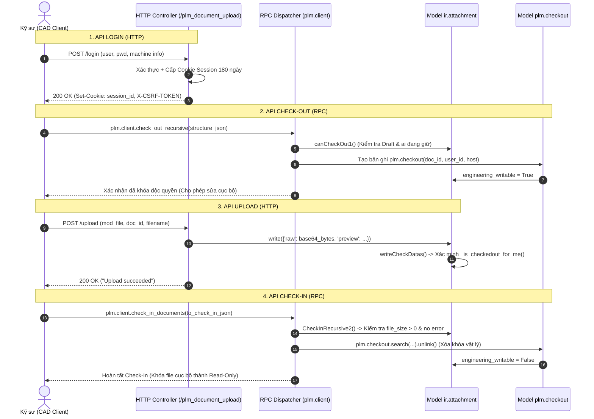

# BÁO CÁO PHÂN TÍCH SOURCE CODE: API LOGIN, UPLOAD, CHECK-IN, CHECK-OUT
## HỆ THỐNG TÍCH HỢP ODOO 20 PLM VỚI PHẦN MỀM CAD (SOLIDWORKS / INVENTOR)

> **Loại tài liệu:** Báo cáo Phân tích Kỹ thuật Kiến trúc & Mã nguồn (Technical Architecture & Code Analysis Report)  
> **Nền tảng:** Odoo 20 Enterprise / Community - Phân hệ PLM/PDM  
> **Các module phân tích:**
> - Module gốc: [`addons/plm`](file:///c:/Work/odoo20-docker/addons/plm) (OmniaSolutions OdooPLM Core)
> - Module mở rộng: [`custom_addons/tdb_plm_custom`](file:///c:/Work/odoo20-docker/custom_addons/tdb_plm_custom) (TDB CAD Gateway Extension)

---

## MỤC LỤC
1. [TỔNG QUAN KIẾN TRÚC GIAO TIẾP & VÒNG ĐỜI 4 API](#1-tổng-quan-kiến-trúc-giao-tiếp--vòng-đời-4-api)
2. [API 1: LOGIN (XÁC THỰC, CẤP SESSION 180 NGÀY & ĐIỀU PHỐI RPC)](#2-api-1-login-xác-thực-cấp-session-180-ngày--điều-phối-rpc)
3. [API 2: UPLOAD (TIẾP NHẬN FILE CAD NHỊ PHÂN & GHI VÀO ORM)](#3-api-2-upload-tiếp-nhận-file-cad-nhị-phân--ghi-vào-orm)
4. [API 3: CHECK-OUT (CƠ CHẾ KHÓA ĐỘC QUYỀN & CHỐNG RACE CONDITION)](#4-api-3-check-out-cơ-chế-khóa-độc-quyền--chống-race-condition)
5. [API 4: CHECK-IN (THẨM ĐỊNH TOÀN VẸN & GIẢI PHÓNG KHÓA PLM.CHECKOUT)](#5-api-4-check-in-thẩm-định-toàn-vẹn--giải-phóng-khóa-plmcheckout)
6. [BẢNG TỔNG HỢP THÔNG SỐ KỸ THUẬT 4 API (QUICK REFERENCE)](#6-bảng-tổng-hợp-thông-số-kỹ-thuật-4-api-quick-reference)
7. [KỊCH BẢN KIỂM THỬ GIẢ LẬP ĐẦU-CUỐI (PYTHON & CURL SCRIPT)](#7-kịch-bản-kiểm-thử-giả-lập-đầu-cuối-python--curl-script)

---

## 1. TỔNG QUAN KIẾN TRÚC GIAO TIẾP & VÒNG ĐỜI 4 API

Hệ thống giao tiếp giữa ứng dụng CAD Desktop Add-in (SolidWorks/Inventor) và Odoo Backend sử dụng mô hình **Kiến trúc Lai (Hybrid Architecture)** phân định rõ 2 kênh truyền thông:
- **Kênh HTTP/REST:** Dùng cho **Login** (xác thực và thiết lập Cookie phiên) và **Upload** (truyền tải dữ liệu nhị phân dung lượng lớn của file CAD).
- **Kênh RPC (XML-RPC / JSON-RPC):** Dùng cho **Check-Out** và **Check-In** (điều phối nghiệp vụ khóa bản quyền, kiểm tra trạng thái vòng đời và quan hệ lắp ráp BOM).



---

## 2. API 1: LOGIN (XÁC THỰC, CẤP SESSION 180 NGÀY & ĐIỀU PHỐI RPC)

### 2.1. Thông Tin Định Danh & Mã Nguồn
- **Giao thức & Endpoint:** `POST /plm_document_upload/login` (HTTP, `auth="none"`, `csrf=False`).
- **File mã nguồn gốc:** [`addons/plm/controllers/main.py`](file:///c:/Work/odoo20-docker/addons/plm/controllers/main.py#L108-L129) -> Class `UploadDocument`.
- **File kế thừa mở rộng:** [`custom_addons/tdb_plm_custom/controllers/plm_upload_controller.py`](file:///c:/Work/odoo20-docker/custom_addons/tdb_plm_custom/controllers/plm_upload_controller.py#L18-L85) -> Class `TdbPlmUploadDocument`.
- **File vá điều phối RPC:** [`custom_addons/tdb_plm_custom/controllers/plm_rpc_controller.py`](file:///c:/Work/odoo20-docker/custom_addons/tdb_plm_custom/controllers/plm_rpc_controller.py#L28-L65) -> Hàm `_cad_dispatch_rpc`.

### 2.2. Tham Số Vào/Ra (Input / Output)
- **Request Headers:**
  - `X-Machine-UUID`: Mã định danh phần cứng máy tính (String).
  - `X-Machine-Name`: Tên máy trạm CAD (String, VD: `WS-DESIGN-01`).
  - `X-CAD-Version`: Phiên bản CAD đang dùng (String, VD: `SolidWorks 2022`).
- **Request Body (Form-Data):**
  - `login`: Tên tài khoản Odoo (String, bắt buộc).
  - `password`: Mật khẩu tài khoản (String, bắt buộc).
  - `db`: Tên cơ sở dữ liệu đích (String, VD: `odoo20`).
- **Response Headers:**
  - `Set-Cookie: session_id=<sid>; Max-Age=15552000; HttpOnly; SameSite=Lax`.
  - `X-CSRF-TOKEN: <csrf_token_string>`.
- **HTTP Status Code:** `200 OK` (thành công), `401 Unauthorized` (sai tài khoản hoặc phiên bị thu hồi), `500 Server Error` (sai database).

### 2.3. Luồng Xử Lý Mã Nguồn (Code Flow)
1. **Khắc phục lỗi RPC trên Odoo 20 ([`plm_rpc_controller.py`](file:///c:/Work/odoo20-docker/custom_addons/tdb_plm_custom/controllers/plm_rpc_controller.py)):**
   - Trước khi gửi POST Login, CAD Client gọi RPC `service='db', method='list'` để nạp danh sách Database lên giao diện.
   - Odoo 20 mặc định loại bỏ service `db` gây lỗi `ValueError: Invalid service name: db`.
   - Bản vá `router.dispatch_rpc = _cad_dispatch_rpc` chặn và xử lý riêng request này, trả về danh sách database hợp lệ giúp CAD Client vượt qua bước kiểm tra kết nối ban đầu.
2. **Xác thực tài khoản qua Odoo 20 Core:**
   ```python
   # Gọi hàm authenticate chuẩn của Odoo 20
   credential = {"type": "password", "login": login, "password": password}
   uid = authenticate(request.session, request.env, credential).get("uid")
   if not uid:
       return Response("Wrong login/password", status=401)
   save_session(request, request.env)
   ```
3. **Ép hạn Cookie 180 ngày và ghi nhận máy trạm ([`plm_upload_controller.py`](file:///c:/Work/odoo20-docker/custom_addons/tdb_plm_custom/controllers/plm_upload_controller.py)):**
   ```python
   # Ghi đè thời hạn cookie thành 180 ngày (15,552,000s)
   res.set_cookie('session_id', sid, max_age=180*24*3600, httponly=True, samesite='Lax')

   # Đăng ký token máy trạm vào model plm.desktop.token
   request.env['plm.desktop.token'].sudo().register_session_token(
       user_id=request.session.uid,
       session_id=sid,
       machine_uuid=machine_uuid,
       machine_name=machine_name,
       client_ip=client_ip,
       cad_version=cad_version,
   )
   ```
4. **Kiểm soát phiên Gatekeeper ([`ir_http.py`](file:///c:/Work/odoo20-docker/custom_addons/tdb_plm_custom/models/ir_http.py)):**
   - Hook `IrHttp._authenticate` kiểm tra token tại mỗi request tiếp theo; nếu Admin bấm **Revoke** trên Odoo, hệ thống lập tức ngắt phiên và trả về mã lỗi `401 Unauthorized`.

---

## 3. API 2: UPLOAD (TIẾP NHẬN FILE CAD NHỊ PHÂN & GHI VÀO ORM)

### 3.1. Thông Tin Định Danh & Mã Nguồn
- **Giao thức & Endpoint:** `POST /plm_document_upload/upload` (HTTP Multipart, `auth="user"`, `csrf=False`).
- **File mã nguồn:** [`addons/plm/controllers/main.py`](file:///c:/Work/odoo20-docker/addons/plm/controllers/main.py#L161-L194) -> Method `UploadDocument.upload`.
- **Model xử lý ORM:** [`addons/plm/models/ir_attachment.py`](file:///c:/Work/odoo20-docker/addons/plm/models/ir_attachment.py#L1435) -> Method `writeCheckDatas`.

### 3.2. Tham Số Vào/Ra (Input / Output)
- **Request Headers:** `Cookie: session_id=<sid>`, `X-CSRF-TOKEN: <token>`.
- **Request Body (Multipart/form-data):**
  - `doc_id`: ID của tài liệu `ir.attachment` trong Odoo (JSON string, VD: `"1024"`).
  - `filename`: Tên file gốc (String, VD: `"flange_d200.sldprt"`).
  - `mod_file`: Luồng dữ liệu file nhị phân (Binary stream).
  - `preview` *(tùy chọn)*: Luồng file ảnh chụp nhanh mô hình CAD (Binary stream).
  - `hostname`, `hostpws`, `dbThread`: Thông tin máy trạm lưu vết thao tác.
- **Response:** HTTP `200 OK` (`"Upload succeeded"`) hoặc `400 Bad Request` (`"Failed upload"`).

### 3.3. Luồng Xử Lý Mã Nguồn (Code Flow)
1. **Giải mã tham số & Đọc luồng nhị phân:**
   ```python
   doc_id = json.loads(doc_id)
   raw_bytes = mod_file.stream.read()
   to_write = {
       "raw": base64.b64encode(raw_bytes).decode(),
       "name": filename
   }
   if preview:
       to_write["preview"] = base64.b64encode(preview.stream.read()).decode()
   ```
2. **Thẩm tra quyền tài liệu (`_plm_document`):**
   ```python
   ir_attachment_id = request.env["ir.attachment"].search([
       ("id", "=", doc_id), ("is_plm", "=", True)
   ], limit=1)
   ```
3. **Kiểm tra nghiệp vụ PDM khi ghi (`ir.attachment.writeCheckDatas`):**
   Khi `ir_attachment_id.write(to_write)` được gọi, Odoo thực hiện 2 kiểm tra bắt buộc:
   - **Phải là người đang giữ Check-out:** `attachment._is_checkedout_for_me() == True`. Nếu người khác đang giữ hoặc file chưa check-out, hệ thống ném lỗi:
     `UserError: You cannot edit a file not in check-out by you!`
   - **Trạng thái cho phép ghi:** `attachment.is_plm_state_writable() == True` (chỉ cho phép ở trạng thái *Draft/Undraft*; nếu đã *Released* thì chặn ghi tuyệt đối).
4. **Hậu xử lý sau khi lưu file:**
   - Cập nhật ảnh đại diện sản phẩm liên quan: `ir_attachment_id.sudo().update_component_preview()`.
   - Ghi nhật ký máy trạm lưu file vào model `plm.cad.open`: `setupCadOpen(hostname, pws_path, operation_type='save')`.

---

## 4. API 3: CHECK-OUT (CƠ CHẾ KHÓA ĐỘC QUYỀN & CHỐNG RACE CONDITION)

### 4.1. Thông Tin Định Danh & Mã Nguồn
- **Giao thức:** XML-RPC / JSON-RPC (`service='object'`, `method='execute_kw'`).
- **Điểm truy cập điều phối:** Model [`plm.client`](file:///c:/Work/odoo20-docker/addons/plm/models/plm_client.py#L211) -> Method `check_out_recursive`.
- **Model kiểm soát khóa:** Model [`plm.checkout`](file:///c:/Work/odoo20-docker/addons/plm/models/plm_checkout.py) (Bảng CSDL `plm_checkout`).
- **Model logic nghiệp vụ:** [`addons/plm/models/ir_attachment.py`](file:///c:/Work/odoo20-docker/addons/plm/models/ir_attachment.py#L2722) -> Method `checkout` & `canCheckOut1`.

### 4.2. Tham Số Vào/Ra (Input / Output)
- **RPC Arguments:**
  - `structure_json`: Chuỗi JSON mảng các đối tượng chi tiết cần Check-out:
    `[{"engineering_code": "PART-001", "engineering_revision": 0, "checkout": true, "name": "part.sldprt"}]`
  - `pws_path`: Thư mục làm việc cá nhân cục bộ trên máy kỹ sư (VD: `"C:/PWS"`).
  - `hostname`: Tên máy trạm thực hiện Check-out (VD: `"WS-CAD-01"`).
  - `force`: Cờ ép buộc (Boolean, mặc định `False`).
- **Dữ liệu trả về (Return JSON):** Chuỗi JSON cập nhật trạng thái của từng file kèm các cờ: `checkout: bool`, `err_msg: str`.

### 4.3. Luồng Xử Lý Thẩm Định & Cấp Khóa Độc Quyền
1. **Thẩm tra điều kiện Check-out ([`canCheckOut1`](file:///c:/Work/odoo20-docker/addons/plm/models/ir_attachment.py#L2754)):**
   - **Điều kiện 1 (Vòng đời):** `docBrws.engineering_state in ['draft', False]`. Nếu file đã phát hành (`released`), trả về cờ `'check_out_released'` kèm thông báo từ chối.
   - **Điều kiện 2 (Xung đột người dùng qua `isCheckedOutByMeOr`):**
     - Nếu đã được Check-out bởi chính user trên máy đó $\rightarrow$ Cờ `'check_out_by_me'` (Cho phép tiếp tục thao tác).
     - Nếu đang bị người khác giữ khóa $\rightarrow$ Cờ `'check_out_by_user'` kèm tên người đang giữ và máy trạm của họ. Hệ thống **từ chối cấp quyền**.
     - Nếu chưa ai khóa $\rightarrow$ Cờ `'check_in'` (Sẵn sàng cấp khóa).
2. **Cấp khóa vật lý cấp CSDL ([`plm.checkout.create`](file:///c:/Work/odoo20-docker/addons/plm/models/plm_checkout.py#L84)):**
   - Tạo bản ghi mới trong bảng `plm_checkout`:
     ```python
     self.env["plm.checkout"].create({
         "userid": self.env.uid,
         "hostname": hostname,
         "hostpws": pws_path,
         "documentid": document.id,
     })
     ```
3. **Cơ chế chống Race Condition (ACID Lock):**
   - Model `plm.checkout` định nghĩa ràng buộc duy nhất tại PostgreSQL:
     ```python
     _documentid = models.Constraint("unique (documentid)", "The documentid must be unique !")
     ```
   - Nếu 2 kỹ sư cùng bấm Check-out 1 file tại cùng 1 thời điểm, PostgreSQL sẽ khóa dòng và từ chối giao dịch thứ 2 ngay tại tầng database, bảo vệ tính toàn vẹn 100%.
4. **Kích hoạt quyền ghi:**
   - Gán `document.engineering_writable = True`.
   - Ghi vết chatter: `message_post(body="Checked-Out ID ...")`.
   - Bật cờ cảnh báo cập nhật cho các máy khác: `assign_must_update_flag()`.

---

## 5. API 4: CHECK-IN (THẨM ĐỊNH TOÀN VẸN & GIẢI PHÓNG KHÓA PLM.CHECKOUT)

### 5.1. Thông Tin Định Danh & Mã Nguồn
- **Giao thức:** XML-RPC / JSON-RPC (`service='object'`, `method='execute_kw'`).
- **Điểm truy cập điều phối:** Model [`plm.client`](file:///c:/Work/odoo20-docker/addons/plm/models/plm_client.py#L183) -> Method `check_in_documents`.
- **Model thực thi gỡ khóa:** Model [`plm.checkout`](file:///c:/Work/odoo20-docker/addons/plm/models/plm_checkout.py#L104) -> Method `unlink`.
- **Model kiểm tra dữ liệu:** [`addons/plm/models/ir_attachment.py`](file:///c:/Work/odoo20-docker/addons/plm/models/ir_attachment.py#L3541) -> Method `CheckInRecursive2`.

### 5.2. Tham Số Vào/Ra (Input / Output)
- **RPC Arguments:**
  - `to_check_in_json`: Chuỗi JSON danh sách các tài liệu cần hoàn tất:
    `{"to_check_in": [{"id": 1024, "checked": true}]}`
  - `force`: Cờ ép buộc (Boolean, mặc định `False`).
- **Dữ liệu trả về (Return):** Danh sách các ID tài liệu đã hoàn tất Check-In thành công: `[1024]`.

### 5.3. Luồng Xử Lý Giải Phóng Khóa & Đóng Chu Kỳ
1. **Xác thực quyền sở hữu khóa:**
   - Hệ thống tìm bản ghi khóa tương ứng trong bảng `plm_checkout`:
     ```python
     checkoutId = self.env["plm.checkout"].search([
         ("documentid", "=", docId.id),
         ("userid", "=", self.env.user.id)
     ])
     ```
   - Chỉ người đang trực tiếp giữ bản ghi khóa mới có quyền thực thi lệnh Check-in cho tài liệu đó.
2. **Cổng kiểm soát lỗi dữ liệu (Error Gate tại [`PlmCheckout.unlink`](file:///c:/Work/odoo20-docker/addons/plm/models/plm_checkout.py#L104)):**
   - Trước khi cho phép xóa bản ghi khóa, hệ thống kiểm tra cờ lỗi:
     ```python
     if checkObj.documentid.has_error:
         raise UserError(f"Unable to check-in due to an error on saving document: {checkObj.documentid.getLastError()}")
     ```
   - Nếu quá trình Upload file trước đó gặp lỗi (mất mạng, byte rỗng), lệnh Check-in bị chặn đứng nhằm bảo toàn khóa, tránh mất dữ liệu thiết kế của kỹ sư.
3. **Giải phóng khóa và chuyển trạng thái:**
   - Gọi `checkoutId.unlink()`: Xóa bản ghi trong bảng `plm_checkout`.
   - Chuyển quyền ghi về chế độ Read-Only: `document.engineering_writable = False`.
   - Ghi vết chatter lịch sử: `document.message_post(body="Checked-In")`.
   - Bắn cờ `assign_must_update_flag()` thông báo cho toàn bộ mạng nội bộ rằng bản vẽ đã có phiên bản hoàn tất mới.

---

## 6. BẢNG TỔNG HỢP THÔNG SỐ KỸ THUẬT 4 API (QUICK REFERENCE)

| Thuộc tính | 1. API Login | 2. API Upload | 3. API Check-Out | 4. API Check-In |
| :--- | :--- | :--- | :--- | :--- |
| **Giao thức** | HTTP POST Form | HTTP POST Multipart | XML-RPC / JSON-RPC | XML-RPC / JSON-RPC |
| **Endpoint / Method** | `/plm_document_upload/login` | `/plm_document_upload/upload` | `plm.client.check_out_recursive` | `plm.client.check_in_documents` |
| **Xác thực (Auth)** | `auth="none"` | `auth="user"` (Session Cookie) | RPC (User ID + Password/Key) | RPC (User ID + Password/Key) |
| **Input chính** | `login`, `password`, `db`, Hardware UUID | `doc_id`, `filename`, `mod_file` (stream) | `structure_json`, `pws_path`, `hostname` | `to_check_in_json` (danh sách ID) |
| **Hành động CSDL** | Ghi `plm.desktop.token`, cấp Cookie 180 ngày | Ghi `raw` vào `ir.attachment`, cập nhật preview | `INSERT INTO plm_checkout` (Unique lock) | `DELETE FROM plm_checkout` (Unlink) |
| **Kiểm tra cốt lõi** | Mật khẩu đúng + Token chưa bị Revoke | `_is_checkedout_for_me` + State Writable | `canCheckOut1` (Draft + Chưa ai khóa) | Người gỡ phải là người giữ + `has_error == False` |
| **Trạng thái file** | Khởi tạo phiên kết nối | Lưu trữ nội dung CAD mới nhất | `engineering_writable = True` | `engineering_writable = False` (Read-Only) |

---

## 7. KỊCH BẢN KIỂM THỬ GIẢ LẬP ĐẦU-CUỐI (PYTHON & CURL SCRIPT)

### 7.1. Kịch Bản Python (~25 Dòng Chạy Trọn Vẹn 4 API)

```python
import requests, xmlrpc.client, json

HOST = "http://localhost:8069"
DB, USER, PWD = "odoo20", "admin", "admin"
DOC_ID, ENG_CODE, FILE_NAME = 1024, "CAD-PRT-001", "part_flange.sldprt"

# 1. LOGIN: HTTP POST xác thực và nhận Cookie 180 ngày
session = requests.Session()
login_res = session.post(
    f"{HOST}/plm_document_upload/login",
    data={"login": USER, "password": PWD, "db": DB},
    headers={"X-Machine-UUID": "TEST-UUID-01", "X-Machine-Name": "WS-QA-TEST"}
)
assert login_res.status_code == 200, f"Login failed: {login_res.text}"
csrf_token = login_res.headers.get("X-CSRF-TOKEN")
print(f"[1/4] Login OK! Cookie: {session.cookies.get('session_id')[:12]}...")

# 2. CHECK-OUT: RPC xin khóa ghi độc quyền plm.checkout
common = xmlrpc.client.ServerProxy(f"{HOST}/xmlrpc/2/common")
uid = common.authenticate(DB, USER, PWD, {})
models = xmlrpc.client.ServerProxy(f"{HOST}/xmlrpc/2/object")

checkout_struct = json.dumps([{"engineering_code": ENG_CODE, "engineering_revision": 0, "checkout": True, "name": FILE_NAME}])
out_res = models.execute_kw(DB, uid, PWD, "plm.client", "check_out_recursive", [checkout_struct, "C:/PWS", "WS-QA-TEST"])
print(f"[2/4] Check-out OK (Đã khóa plm.checkout): {out_res}")

# 3. UPLOAD: HTTP POST stream file nhị phân mới lên server
cad_bytes = b"MOCK_CAD_SOLIDWORKS_BINARY_STREAM_CONTENT_V2"
files = {"mod_file": (FILE_NAME, cad_bytes, "application/octet-stream")}
upload_data = {"doc_id": json.dumps(DOC_ID), "filename": FILE_NAME, "hostname": "WS-QA-TEST"}
up_res = session.post(f"{HOST}/plm_document_upload/upload", data=upload_data, files=files, headers={"X-CSRF-TOKEN": csrf_token})
assert up_res.status_code == 200, f"Upload thất bại: {up_res.text}"
print(f"[3/4] Upload CAD OK: {up_res.text}")

# 4. CHECK-IN: RPC gỡ khóa plm.checkout, đưa file về Read-Only
checkin_struct = json.dumps({"to_check_in": [{"id": DOC_ID, "checked": True}]})
in_res = models.execute_kw(DB, uid, PWD, "plm.client", "check_in_documents", [checkin_struct])
print(f"[4/4] Check-in OK (Đã gỡ khóa & hoàn tất chu trình): {in_res}")
```

### 7.2. Lệnh cURL Nhanh Cho Đội Ngũ QA / DevOps

```bash
# Bước 1: Login và lưu Session Cookie vào file cookies.txt
curl -X POST -c cookies.txt \
     -H "X-Machine-UUID: QA-TEST-UUID-01" \
     -H "X-Machine-Name: WS-QA-TEST" \
     -d "login=admin&password=admin&db=odoo20" \
     http://localhost:8069/plm_document_upload/login

# Bước 2: Upload file CAD nhị phân (sử dụng Cookie đã lưu ở Bước 1)
curl -X POST -b cookies.txt \
     -F "doc_id=1024" \
     -F "filename=part_flange.sldprt" \
     -F "hostname=WS-QA-TEST" \
     -F "mod_file=@part_flange.sldprt;type=application/octet-stream" \
     http://localhost:8069/plm_document_upload/upload
```
